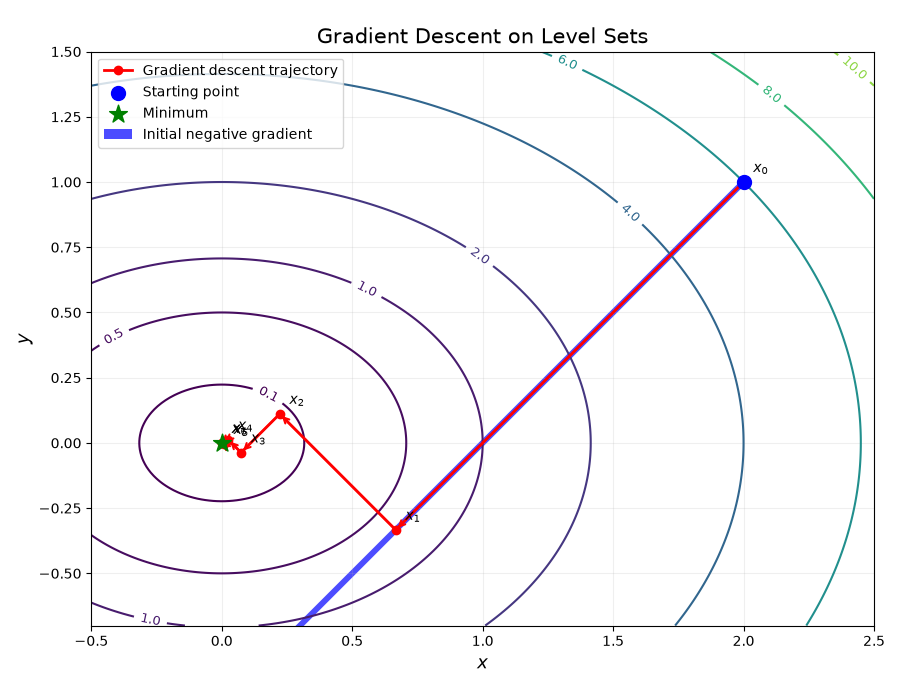
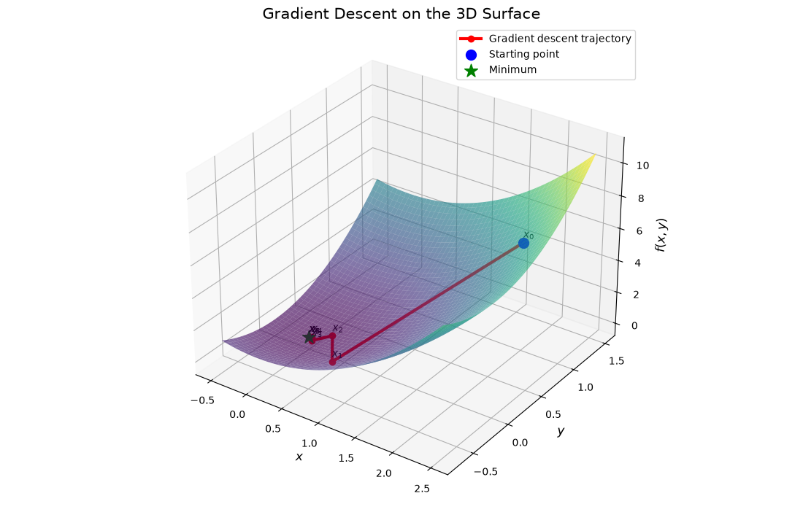
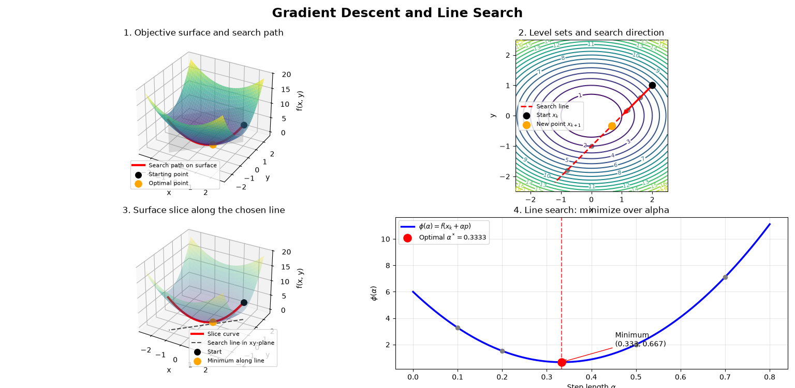

# Lecture: Gradient Descent, Line Search, and Approximate Line-Search Methods

# Part 0. Gradient Descent: The Complete Algorithm

## 0.1 The optimization problem

Consider an unconstrained optimization problem:

$$
\min_{x\in\mathbb{R}^n} f(x)
$$

where $f:\mathbb{R}^n\rightarrow\mathbb{R}$ is a differentiable objective function.

Our objective is to find a point $x^*$ that minimizes the function.

For simple functions, we may calculate the minimum analytically by solving:

$$
\nabla f(x)=0.
$$

However, for complicated functions, especially those encountered in machine learning, finding an analytical solution is generally impractical.

Instead, we use an iterative algorithm: we start from an initial point and repeatedly move toward points with lower objective values.

This is the central idea of **gradient descent**.

## 0.2 The geometric intuition: Moving downhill

Imagine that the objective function is a three-dimensional surface.

- The horizontal coordinates represent the optimization variables.
- The vertical coordinate represents the objective value $f(x)$.
- A point on the surface represents a candidate solution.

Our goal is to move from our initial position toward a point with a lower height.

At each iteration, we stand at the current point and make two decisions:

1. Which direction should we take?
2. How far should we move in that direction?

These two decisions define the gradient descent algorithm.

## 0.3 Understanding the algorithm through level sets

Consider the following two-dimensional function:

$$
f(x,y)=x^2+2y^2.
$$

Its gradient is:

$$
\nabla f(x,y)=
\begin{pmatrix}
2x\\\\
4y
\end{pmatrix}.
$$

The minimum is located at:

$$
x^{\*}=(0,0),\qquad f(x^\*)=0.
$$

Suppose we start at:

$$
x_0=(2,1).
$$

The corresponding objective value is:

$$
f(2,1)=6.
$$

A level set is a collection of points having the same objective value:

$$
f(x,y)=c.
$$

For our example:

$$
x^2+2y^2=c.
$$

These level sets are ellipses centered at the minimum.

They provide a two-dimensional representation of the optimization landscape.

**Geometric interpretation:**

- Each ellipse represents a constant objective value.
- Moving toward smaller ellipses means decreasing the objective.
- The center represents the global minimum.
- The gradient is perpendicular to the level set passing through the current point.
- The negative gradient points toward the direction of the most rapid local decrease.

At the initial point:

$$
\nabla f(2,1)=
\begin{pmatrix}
4\\\\
4
\end{pmatrix}.
$$

Therefore, the negative-gradient direction is:

$$
d_0=
\begin{pmatrix}
-4\\\\
-4
\end{pmatrix}.
$$

The algorithm moves from $(2,1)$ along this direction.

Figure 1. Level sets show the ellipses, initial point, negative gradient, and candidate movement. Level sets show how the algorithm moves across the optimization domain.

## 0.4 Understanding the same movement on the 3D surface

The same function can be represented as a three-dimensional surface:

$$
z=f(x,y)=x^2+2y^2.
$$

The initial point on this surface is:

$$
P_0=(2,1,6).
$$

The horizontal projection of the negative-gradient direction is $(-4,-4)$.

A candidate movement is described by:

$$
x(\alpha)=
\begin{pmatrix}
2\\\\
1
\end{pmatrix}
+
\alpha
\begin{pmatrix}
-4\\\\
-4
\end{pmatrix}.
$$

The corresponding points on the surface have coordinates:

$$
P(\alpha)=
\left(
2-4\alpha,\;
1-4\alpha,\;
f(2-4\alpha,1-4\alpha)
\right).
$$

As we vary $\alpha$, we obtain different positions along the same path on the surface.

The important observation is that the direction determines the path, but it does not determine where we should stop.

This leads to the two fundamental decisions of gradient descent.

Figure 2. 3D surface, show the quadratic bowl and the corresponding descent path. - 3D surface shows how this movement corresponds to decreasing the objective value.

## 0.5 The gradient descent iteration

The general update rule is:

$$
\boxed{x_{k+1}=x_k+\alpha_k d_k}
$$

where:

- $x_k$ is the current point.
- $d_k$ is the chosen search direction.
- $\alpha_k>0$ is the step size.
- $x_{k+1}$ is the next point.

The algorithm repeats this process:

1. Start from an initial point $x_0$.
2. Compute the gradient at the current point.
3. Choose a descent direction.
4. Determine an appropriate step size.
5. Update the current point.
6. Repeat until a stopping criterion is satisfied.

The algorithm can be summarized as:

$$
x_k
\longrightarrow
d_k
\longrightarrow
\alpha_k
\longrightarrow
x_{k+1}.
$$

## 0.6 Three fundamental questions

The algorithm raises three questions that will organize the rest of this lecture.

**Question 1: Which direction should we choose?**

At a given point, many directions may lead to a decrease in the objective.

But which one should we prefer?

Gradient descent chooses the direction of steepest local decrease: the negative gradient.

We will justify this choice mathematically using the first-order Taylor approximation and the Cauchy–Schwarz inequality.

**Question 2: How far should we move?**

Even if we have selected a good direction, the step size matters.

- A very small step may produce negligible progress.
- A suitable step may produce substantial progress.
- A very large step may overshoot the minimum or even increase the objective.

We therefore need a systematic way to select the step size.

This leads to the concept of **line search**.

**Question 3: What if the exact step size is difficult or expensive to calculate?**

In principle, we could solve:

$$
\alpha_k^\*=
\arg\min_{\alpha\geq 0}
f(x_k+\alpha d_k).
$$

This is called exact line search.

However, solving this problem exactly may be analytically difficult or computationally expensive.

Instead, we can search for an approximate step that satisfies appropriate acceptance conditions.

For example:

- Armijo condition: require sufficient decrease in the objective.
- Wolfe conditions: require sufficient decrease and an appropriate change in the directional derivative.

The goal is not necessarily to find the best possible step along the line, but to find a step that provides reliable progress without unnecessary computational cost.

---

**The central idea**

Gradient descent is an iterative process built around three decisions:

1. Select a direction that locally decreases the objective.
2. Select a suitable distance to move along that direction.
3. If the exact distance is difficult to compute, use an approximation that satisfies appropriate conditions.

The following parts of this lecture develop these three ideas mathematically.

# Part I. Gradient Descent: Choosing a Direction

## 1. The optimization problem

We consider an unconstrained optimization problem:

$$
\min_{x\in\mathbb{R}^n} f(x),
$$

where $f:\mathbb{R}^n\rightarrow\mathbb{R}$ is a differentiable objective function.

Our goal is to find a point $x^\*$ that minimizes $f$.

For complicated functions, it may be difficult or impossible to solve the optimization problem analytically. Instead, we construct a sequence of points:

$$
x_0,x_1,x_2,\ldots
$$

such that the objective generally decreases as the algorithm progresses.

The general iterative update is

$$
\boxed{x_{k+1}=x_k+\alpha_k d_k}
$$

where:

- $x_k$ is the current point.
- $d_k$ is the direction of movement.
- $\alpha_k>0$ is the step size.
- $x_{k+1}$ is the next point.

This formula separates two decisions:

1. **Direction:** Which way should we move?
2. **Step size:** How far should we move?

Gradient descent answers the first question using the gradient.

## 2. First-order Taylor approximation

Near a point $x$, the first-order Taylor approximation of $f$ is

$$
f(x+\Delta x)
\approx f(x)+\nabla f(x)^T\Delta x.
$$

If we choose a displacement $\Delta x=\alpha d$, then

$$
f(x+\alpha d)
\approx f(x)+\alpha\nabla f(x)^Td.
$$

For a small positive $\alpha$, the predicted change in the objective is

$$
\Delta f\approx\alpha\nabla f(x)^Td.
$$

Therefore, to obtain a local decrease, we want

$$
\nabla f(x)^Td<0.
$$

This condition defines a descent direction: a direction in which sufficiently small positive steps decrease the function.

## 3. Why is the negative gradient the steepest-descent direction?

We seek the unit direction $d$ that produces the largest decrease per unit displacement. Mathematically, we solve

$$
\min_{\|d\|=1}\nabla f(x)^Td.
$$

By the Cauchy–Schwarz inequality,

$$
\nabla f(x)^Td
\geq -\|\nabla f(x)\|\|d\|.
$$

Because $\|d\|=1$,

$$
\nabla f(x)^Td\geq-\|\nabla f(x)\|.
$$

Equality occurs when $d$ points in the direction opposite to the gradient:

$$
\boxed{d^\*=-\frac{\nabla f(x)}{\|\nabla f(x)\|}}.
$$

Thus, the negative gradient is the direction of steepest local decrease under the Euclidean norm.

In standard gradient descent, we absorb the normalization into the step size and write

$$
\boxed{x_{k+1}=x_k-\alpha_k\nabla f(x_k)}.
$$

The negative gradient determines the direction; the step size determines the displacement magnitude.

---

## 4. Example 1: One-dimensional quadratic function

Consider

$$
f(x)=x^2,\qquad f'(x)=2x.
$$

The minimum is at $x^\*=0$.

Suppose we start from $x_0=3$. Gradient descent gives

$$
x_{k+1}=x_k-\alpha(2x_k).
$$

Therefore,

$$
\boxed{x_{k+1}=(1-2\alpha)x_k}.
$$

This simple expression allows us to analyze the effect of the step size.

### Case A: $0<\alpha<1/2$

Then

$$
0<1-2\alpha<1.
$$

The iterates move toward zero without changing sign. Convergence is geometric.

### Case B: $\alpha=1/2$

Then

$$
x_{k+1}=0.
$$

The minimum is reached in one step.

### Case C: $1/2<\alpha<1$

Then

$$
-1<1-2\alpha<0.
$$

The iterates alternate around zero, but their magnitudes decrease.

### Case D: $\alpha\geq1$

The magnitude of the multiplier is at least one. Starting from a nonzero point, the algorithm does not converge to zero.

### Lesson

Even when the descent direction is correct, the algorithm may converge slowly, oscillate, or diverge depending on the step size.

This motivates the next question:

**Can we choose the step size systematically instead of fixing it arbitrarily?**

---

# Part II. Why the Step Size Matters

## 5. A two-dimensional example

Consider

$$
f(x,y)=x^2+2y^2.
$$

Its gradient is

$$
\nabla f(x,y)=
\begin{pmatrix}
2x\\\\
4y
\end{pmatrix}.
$$

The global minimum is

$$
(x^\*,y^\*)=(0,0).
$$

Start at

$$
p=(2,1).
$$

The gradient is

$$
\nabla f(2,1)=
\begin{pmatrix}
4\\\\
4
\end{pmatrix}.
$$

The negative-gradient direction is

$$
d=
\begin{pmatrix}
-4\\\\
-4
\end{pmatrix}.
$$

The update is

$$
x(\alpha)=
\begin{pmatrix}
2\\\\
1
\end{pmatrix}
+\alpha
\begin{pmatrix}
-4\\\\
-4
\end{pmatrix}.
$$

Equivalently,

$$
x(\alpha)=
\begin{pmatrix}
2-4\alpha\\\\
1-4\alpha
\end{pmatrix}.
$$

Every positive $\alpha$ gives a point on the same line.

However, different step sizes give different objective values. The direction alone does not determine the best next point.

For example:

- A very small step makes limited progress.
- A suitable step produces a substantial decrease.
- A large step may pass beyond the best point on that line.

This is the motivation for line search.

---

# Part III. Line Search: Choosing the Distance

## 6. Reduce the multidimensional problem to one dimension

Suppose the current point is $x_k$ and the chosen descent direction is $d_k$.

All candidate points along this direction have the form

$$
x_k+\alpha d_k,\qquad \alpha\geq0.
$$

Define the one-dimensional function

$$
\boxed{\phi(\alpha)=f(x_k+\alpha d_k)}.
$$

The original function may depend on many variables, but after fixing the direction, the line-search problem depends on only one variable: $\alpha$.

The exact line-search problem is

$$
\boxed{
\alpha_k^*
=\arg\min_{\alpha\geq0}
f(x_k+\alpha d_k)
}.
$$

The notation $\arg\min$ returns the input that achieves the minimum, not the minimum function value itself.

For example, if

$$
\phi(\alpha)=6-32\alpha+48\alpha^2,
$$

then

$$
\arg\min_{\alpha\geq0}\phi(\alpha)=\frac13,
$$

while

$$
\min_{\alpha\geq0}\phi(\alpha)=\frac23.
$$

The first expression gives the step size; the second gives the objective value after that step.

## 7. Exact line search: a worked example

Return to

$$
f(x,y)=x^2+2y^2,
\qquad p=(2,1),
\qquad d=(-4,-4).
$$

The candidate point is

$$
x(\alpha)=
\begin{pmatrix}
2-4\alpha\\\\
1-4\alpha
\end{pmatrix}.
$$

Substitute it into the original objective:

$$
\begin{aligned}
\phi(\alpha)
&=f(2-4\alpha,1-4\alpha)\\\\
&=(2-4\alpha)^2+2(1-4\alpha)^2\\\\
&=4-16\alpha+16\alpha^2\\\\
&\quad+2(1-8\alpha+16\alpha^2)\\\\
&=\boxed{6-32\alpha+48\alpha^2}.
\end{aligned}
$$

This is a one-dimensional quadratic function.

Differentiate:

$$
\phi'(\alpha)=-32+96\alpha.
$$

An interior minimum satisfies

$$
\phi'(\alpha^*)=0.
$$

Therefore,

$$
-32+96\alpha^*=0
$$

and

$$
\boxed{\alpha^*=\frac13}.
$$

The next point is

$$
x_1=p+\alpha^*d =
\begin{pmatrix}
2\\\\
1
\end{pmatrix}
+\frac13
\begin{pmatrix}
-4\\\\
-4
\end{pmatrix}.
$$

Thus,

$$
\boxed{x_1=\begin{pmatrix}2/3\\\\-1/3\end{pmatrix}}.
$$

The objective decreases from

$$
f(2,1)=6
$$

to

$$
f\left(\frac23,-\frac13\right)
=\frac49+2\left(\frac19\right)
=\frac23.
$$

### Important observation

The new point is not the global minimum $(0,0)$.

Exact line search finds the best point **along the chosen line**, not necessarily the global minimum of the original multidimensional function.

After this step, the gradient changes. The algorithm computes a new direction and performs another iteration.

---

## 8. The directional derivative and the chain rule

Why does differentiating $\phi(\alpha)$ help us choose the step size?

Recall that

$$
\phi(\alpha)=f(p+\alpha d).
$$

The chain rule gives

$$
\boxed{\phi'(\alpha)=\nabla f(p+\alpha d)^Td}.
$$

At the starting point,

$$
\boxed{\phi'(0)=\nabla f(p)^Td}.
$$

This quantity is the directional derivative of $f$ at $p$ in direction $d$. It is also the slope of the one-dimensional line-search function at $\alpha=0$.

### What information does it provide?

First, it tells us the initial rate of change along the chosen direction.

- If $\phi'(0)<0$, small positive steps decrease the objective.
- If $\phi'(0)>0$, small positive steps increase the objective.
- If $\phi'(0)=0$, there is no first-order change along this direction.

Second, it gives a first-order prediction of the objective value at a nearby point:

$$
\boxed{\phi(\alpha)\approx\phi(0)+\alpha\phi'(0)}.
$$

Third, it supplies the reference used by approximate line-search methods, especially Armijo backtracking.

For steepest descent,

$$
d=-\nabla f(p),
$$

so

$$
\phi'(0)
=\nabla f(p)^T[-\nabla f(p)]
=-\|\nabla f(p)\|^2.
$$

Therefore,

$$
\boxed{\phi'(0)=-\|\nabla f(p)\|^2<0}
$$

whenever the gradient is nonzero.

This proves that the negative-gradient direction is a descent direction.

### What does the directional derivative not tell us?

It does not determine the best step size by itself. It gives only the initial slope; the slope may change as we move along the line.

To find the best step, we need additional information about how the function behaves away from the starting point.

---

# Part IV. Why Exact Line Search Can Be Expensive

## 9. When is exact line search easy?

For a quadratic function, the line-search function is also quadratic. Its derivative is linear, so the exact minimum can often be computed directly.

For example,

$$
\phi(\alpha)=6-32\alpha+48\alpha^2
$$

gives

$$
\phi'(\alpha)=-32+96\alpha.
$$

Solving $\phi'(\alpha)=0$ is straightforward.

Exact line search is not inherently expensive. Its cost depends on the function and on how expensive it is to evaluate the objective or its derivatives.

## 10. When does the line-search problem become difficult?

Consider

$$
f(x,y)=e^{x+y}+x^2+2y^2.
$$

At $p=(1,1)$,

$$
\nabla f(1,1)=
\begin{pmatrix}
e^2+2\\\\
e^2+4
\end{pmatrix}.
$$

Choose the negative-gradient direction

$$
d=
-\begin{pmatrix}
e^2+2\\\\
e^2+4
\end{pmatrix}.
$$

The line-search function is

$$
\begin{aligned}
\phi(\alpha)={}&
e^{2-\alpha(2e^2+6)}\\\\
&+[1-\alpha(e^2+2)]^2\\\\
&+2[1-\alpha(e^2+4)]^2.
\end{aligned}
$$

Setting $\phi'(\alpha)=0$ produces a nonlinear equation involving an exponential term and polynomial terms. It does not have a convenient elementary solution.

We can still solve this equation numerically. However, numerical exact line search may require repeated evaluations of the objective and its derivative.

Three sources of cost are particularly important:

1. **No closed-form solution:** The equation defining the exact minimum may be nonlinear and analytically intractable.
2. **Expensive function evaluations:** Each trial step may require a full evaluation of the objective.
3. **Repeated derivative evaluations:** Methods that use the slope at trial points may require new gradient calculations.

For a neural network with millions of parameters, these evaluations may be costly.

There is another difficulty: for nonconvex objectives, the line-search function may have multiple local minima. Finding a stationary point does not automatically identify the global minimum along the line.

### Practical conclusion

Instead of computing the exact line minimum, we often seek a step that gives sufficient decrease while keeping the computational cost reasonable.

---

# Part V. Approximate Line Search

## 11. The main idea

Approximate line-search methods do not necessarily find the minimum of $\phi(\alpha)$.

They aim to find a step that satisfies useful acceptance conditions.

The key question becomes:

**Can we obtain sufficient progress without spending the computation required to find the exact line minimum?**

Different algorithms answer this question in different ways.

---

## 12. Armijo backtracking: sufficient decrease

### 12.1 Motivation

The first-order Taylor approximation at $\alpha=0$ is

$$
\phi(\alpha)\approx\phi(0)+\alpha\phi'(0).
$$

For a descent direction, $\phi'(0)<0$, so the approximation predicts a decrease for small positive steps.

Armijo requires the actual objective to decrease by at least a chosen fraction of the decrease predicted by this linear approximation:

$$
\boxed{
\phi(\alpha)\leq
\phi(0)+c_1\alpha\phi'(0)
}
$$

where

$$
0<c_1<1.
$$

A common choice is $c_1=10^{-4}$.

Because $\phi'(0)<0$, the right-hand side is less than $\phi(0)$. Therefore, the condition requires a sufficient decrease in the actual objective.

### 12.2 Algorithm

Armijo backtracking typically proceeds as follows:

1. Choose an initial trial step, often $\alpha=1$.
2. Evaluate the actual objective $\phi(\alpha)$.
3. Check the Armijo inequality.
4. If the condition fails, shrink the step:

   $$
   \alpha\leftarrow\beta\alpha,
   $$

   where $0<\beta<1$, commonly $\beta=0.5$.
5. Repeat until the condition holds.
6. Accept the step.

Notice that Armijo does not need to solve

$$
\phi'(\alpha)=0.
$$

It uses the initial directional derivative to define the acceptance threshold, but checks the actual objective at each trial point.

### 12.3 Worked example

Use the quadratic line-search function

$$
\phi(\alpha)=6-32\alpha+48\alpha^2.
$$

At the starting point,

$$
\phi(0)=6,
\qquad
\phi'(0)=-32.
$$

Choose

$$
c_1=0.1.
$$

The Armijo condition becomes

$$
\phi(\alpha)\leq6-3.2\alpha.
$$

Start with $\alpha=0.5$.

The actual objective is

$$
\begin{aligned}
\phi(0.5)
&=6-32(0.5)+48(0.5)^2\\\\
&=6-16+12\\\\
&=2.
\end{aligned}
$$

The acceptance threshold is

$$
6-3.2(0.5)=4.4.
$$

Since

$$
2\leq4.4,
$$

Armijo accepts $\alpha=0.5$.

Compare this with the exact line-search solution:

$$
\alpha^*=\frac13.
$$

Armijo accepts a step that is not the exact line minimum. Nevertheless, it gives a sufficient decrease in the objective.

### 12.4 Why this is useful

Armijo avoids the need to find the exact minimum. It simply checks whether each candidate step provides sufficient progress.

It is particularly useful when the objective is expensive to evaluate and a simple, robust line-search method is desired.

---

## 13. Wolfe conditions: sufficient decrease plus curvature

### 13.1 Why add another condition?

Armijo checks that the objective decreases sufficiently. However, it can accept a very small step even when a larger step would be more effective.

Wolfe conditions add a requirement involving the slope at the new point.

The first Wolfe condition is the Armijo condition:

$$
\boxed{
\phi(\alpha)\leq
\phi(0)+c_1\alpha\phi'(0)
}
$$

The second Wolfe condition is

$$
\boxed{\phi'(\alpha)\geq c_2\phi'(0)}
$$

where

$$
0<c_1<c_2<1.
$$

Typical values are $c_1=10^{-4}$ and $c_2=0.9$.

Recall that

$$
\phi'(\alpha)=
\nabla f(x_k+\alpha d_k)^Td_k.
$$

Thus, checking the second Wolfe condition generally requires the gradient at the trial point.

### 13.2 Interpretation of the curvature condition

Because the initial slope is negative, the condition

$$
\phi'(\alpha)\geq c_2\phi'(0)
$$

requires the new slope to be sufficiently less negative than the initial slope, or to have become positive.

It discourages accepting a step that is still too short, where the function continues to decrease steeply along the chosen direction.

### 13.3 Strong Wolfe conditions

A widely used alternative is the strong Wolfe condition:

$$
\boxed{
|\phi'(\alpha)|\leq c_2|\phi'(0)|
}
$$

It bounds the magnitude of the new slope. This also prevents accepting a step whose slope has become strongly positive after overshooting the line minimum.

<!-- Wolfe and strong Wolfe conditions are especially useful in quasi-Newton optimization, including BFGS. -->

### 13.4 Compare Armijo and Wolfe using the same example

For

$$
\phi(\alpha)=6-32\alpha+48\alpha^2,
$$

we have

$$
\phi'(0)=-32,
\qquad
\phi'(\alpha)=-32+96\alpha.
$$

Choose $c_1=0.1$ and $c_2=0.9$.

Consider a small trial step, $\alpha=0.01$.

The actual objective is

$$
\phi(0.01)=6-0.32+0.0048=5.6848.
$$

The Armijo threshold is

$$
6-3.2(0.01)=5.968.
$$

Since

$$
5.6848\leq5.968,
$$

Armijo accepts the step.

However, the new slope is

$$
\phi'(0.01)=-32+96(0.01)=-31.04.
$$

The ordinary Wolfe condition requires

$$
-31.04\geq0.9(-32)=-28.8.
$$

This is false, so Wolfe rejects the step.

The strong Wolfe condition also fails:

$$
|-31.04|>0.9|{-32}|=28.8.
$$

This example illustrates the distinction: Armijo accepts the step because it provides sufficient decrease, while Wolfe rejects it because the slope remains too negative.

---

## 14. Other line-search methods

Several other methods are worth mentioning, even if they are not developed in detail during this lecture.

| Method | Main idea |
|---|---|
| Exact line search | Minimize the original function along the selected line |
| Armijo backtracking | Shrink the step until sufficient decrease holds |
| Wolfe conditions | Require sufficient decrease and a suitable new slope |
| Strong Wolfe | Require sufficient decrease and bound the magnitude of the new slope |
| Goldstein conditions | Bound the acceptable decrease from both sides |
| Interpolation-based search | Use quadratic or cubic models to propose better trial steps |

Interpolation-based methods explicitly construct local polynomial models to propose candidate step sizes. They are often combined with safeguards and acceptance conditions.

It is important to distinguish these methods: **line search is the overall strategy of choosing a step along a direction; Taylor approximation is one possible tool for proposing or assessing that step.**

---

# Part VI. Taylor-Based Step-Size Selection

## 15. When do we use a Taylor approximation?

Taylor approximation provides another way to estimate a step size.

Around $\alpha=0$, approximate the line-search function by

$$
\phi(\alpha)\approx
\phi(0)+\alpha\phi'(0)
+\frac12\alpha^2\phi''(0).
$$

This is a quadratic model of the function along the selected direction.

Differentiate the model:

$$
m'(\alpha)=\phi'(0)+\alpha\phi''(0).
$$

Setting the derivative to zero gives

$$
\boxed{
\alpha_{\text{model}}
=-\frac{\phi'(0)}{\phi''(0)}
}
$$

provided $\phi''(0)>0$ and the resulting step is admissible.

This is a step that minimizes the quadratic model, not necessarily the original function.

For a general nonlinear function, the model may be inaccurate far from $\alpha=0$. A practical algorithm may use this value to propose a step and then check whether the actual objective decreases sufficiently.

### Important distinction

- Exact line search minimizes the original $\phi(\alpha)$.
- A Taylor-based step minimizes an approximation of $\phi(\alpha)$.
- Armijo backtracking checks an acceptance condition using actual function values.
- Wolfe methods check function decrease and slope conditions.

These ideas can be combined in practical optimization algorithms, but they are not identical.

---

# Part VII. Summary Exercise

Consider

$$
f(x,y)=x^2+2y^2
$$

starting from

$$
p=(2,1).
$$

Ask students to complete the following steps.

### Question 1: Compute the gradient

$$
\nabla f(x,y)=
\begin{pmatrix}
2x\\\\4y
\end{pmatrix}.
$$

Evaluate it at $p$.

### Question 2: Determine the descent direction

Use

$$
d=-\nabla f(p).
$$

### Question 3: Define the line-search function

Write

$$
\phi(\alpha)=f(p+\alpha d).
$$

Expand and simplify it.

### Question 4: Compute the directional derivative

Use the chain rule:

$$
\phi'(0)=\nabla f(p)^Td.
$$

Explain why the result is negative.

### Question 5: Perform exact line search

Solve

$$
\phi'(\alpha)=0
$$

and find the exact step size.

### Question 6: Apply Armijo backtracking

Use $c_1=0.1$, initial step $\alpha=1$, and shrinkage factor $\beta=0.5$.

At each trial, check the Armijo inequality and accept the first step that satisfies it.

### Question 7: Compare the results

Compare the accepted Armijo step with the exact line-search step. Calculate the resulting objective values and explain why the two step sizes may differ.

---
<!-- 
# Part VIII. Transition to Newton's Method and Trust Regions

Gradient descent, line search, and approximate line search address different parts of the optimization problem.

Gradient descent chooses a direction from first-order information:

$$
d_k=-\nabla f(x_k).
$$

Line search determines how far to move along that direction:

$$
x_{k+1}=x_k+\alpha_kd_k.
$$

Approximate line-search methods avoid the expense of finding the exact minimum along the line.

The next question is whether we can improve the direction itself by using information about how the gradient changes.

Newton's method uses a second-order local model:

$$
m_k(p)=f(x_k)+\nabla f(x_k)^Tp
+\frac12p^T\nabla^2f(x_k)p.
$$

Minimizing this quadratic model, when the Hessian is invertible, gives the Newton step:

$$
p_k=-[\nabla^2f(x_k)]^{-1}\nabla f(x_k).
$$

A line search can then determine how much of that Newton step to take. Trust-region methods instead constrain the step to a region where the local model is expected to be reliable.

This provides the natural progression:

1. **Gradient descent:** Choose a direction using the gradient.
2. **Line search:** Choose the distance along that direction.
3. **Approximate line search:** Find a sufficient step without solving the line problem exactly.
4. **Newton's method:** Use curvature information to construct a more informed step.
5. **Trust-region methods:** Control the step using the reliability of the local model.

The central lesson is that optimization algorithms must make two related but distinct decisions: where to move and how far to move. Gradient descent and line search separate those decisions, while Newton and trust-region methods introduce richer local models to improve the process. -->
