# Newton and Quasi-Newton Optimization Methods

*A self-contained lecture. Every number below was produced by the companion notebook `newton-lecture-companion.ipynb`, and every figure is in `figures/`.*

---

## How to use this lecture

- **Read it in order.** Each section has the same shape: **Goal → Idea → Derivation → Example → Picture → Check yourself.**
- **Do the "Check yourself" questions before opening the answer.** Answers are hidden in collapsible blocks.
- **Run the notebook next to the text.** Section numbers match. Cells marked 🔧 *Playground* are meant to be edited.
- **Time:** about three sessions of 90 minutes (A: Parts 0–II, B: Part III, C: Parts IV–V). Boxes marked *(optional)* can be skipped on a first reading.

**Prerequisites:** gradient and Hessian, Taylor expansion, positive definite matrices and eigenvalues, gradient descent, line search (Armijo backtracking).

**Notation.** $f:\mathbb R^n\to\mathbb R$ is the objective, $g_k=\nabla f(x_k)$, $H_k=\nabla^2f(x_k)$ (symmetric), $p_k$ is the step, $x_{k+1}=x_k+\alpha_kp_k$. For root finding, $F:\mathbb R^n\to\mathbb R^n$ and $J$ is its Jacobian. $\kappa=\lambda_{\max}/\lambda_{\min}$ is the condition number.

**Roadmap.**

| Part | Question |
|---|---|
| 0 | What is wrong with gradient descent? |
| I | How do we solve $F(x)=0$ by linearization? |
| II | What happens if $F=\nabla f$, and why does it fix gradient descent? |
| III | Why can the Newton step fail, and how do we repair it? |
| IV | Can we avoid computing the Jacobian? |
| V | Can we avoid computing the Hessian (BFGS)? |

---

# Part 0 — The problem: gradient descent zigzags

**Goal.** See, with numbers, the failure we want to cure. Parts I–II will then show how Newton cures it.

We use a **rotated** ellipse, so that nothing can be explained away as "just rescale the coordinates":

$$f(x)=\tfrac12x^TAx,\qquad A=\begin{pmatrix}50.5&49.5\\\\49.5&50.5\end{pmatrix}.$$

Its eigenvalues are $1$ (eigenvector $(1,-1)/\sqrt2$) and $100$ (eigenvector $(1,1)/\sqrt2$), so $\kappa=100$. The minimizer is $x^{*}=0$ and the valley runs along $(1,-1)$.

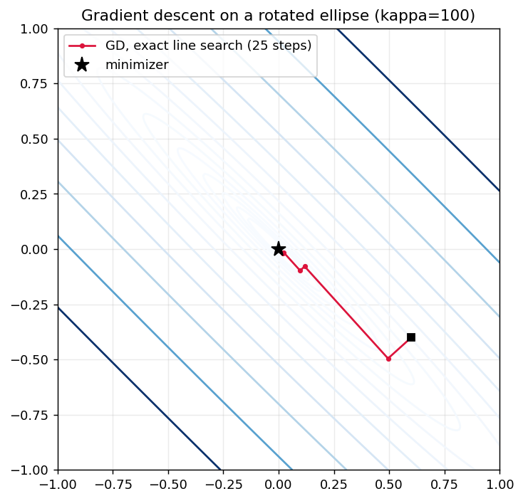

**What to look at.** The red path is gradient descent with *exact* line search from $x_0=(0.6,-0.4)$. It bounces between the two walls of the valley with right-angle turns, while progress along the valley is slow. It needs 41 iterations to reach $\lVert\nabla f\rVert<10^{-8}$ even from this friendly start.

**Why the turns are right angles.** With exact line search, $\phi(\alpha)=f(x_k-\alpha g_k)$ is minimized when $\phi'(\alpha)=-\nabla f(x_{k+1})^Tg_k=0$. So consecutive gradients are orthogonal: $g_{k+1}^Tg_k=0$. In a narrow valley, a path of mutually orthogonal steps must zigzag. The notebook prints these inner products (all $\approx10^{-14}$ or smaller).

> **The promise.** By the end of Part II you will be able to explain exactly why this happens, and Newton's method will solve this problem in **one** step.

---

# Part I — Newton's method for root finding

## 1. The root-finding problem

**Goal.** Fix the vocabulary and separate two problems that are easily confused.

- **Root finding:** given $F:\mathbb R^n\to\mathbb R^n$, find $x$ with $F(x)=0$.
- **Optimization:** given $f:\mathbb R^n\to\mathbb R$, find $x$ minimizing $f$.

They are different problems. A root of some function is not automatically a minimum or a maximum of anything. The two meet in one place: at a local minimizer of a differentiable $f$ we have $\nabla f(x^{*})=0$, which is a root-finding problem for $F=\nabla f$ (Part II).

## 2. Newton–Raphson in one dimension

**Goal.** Derive the update and understand it geometrically.

**Idea.** Replace $F$ near the current point by its tangent line, and jump to where that line crosses zero.

**Derivation.** The first-order Taylor approximation is
$$F(x_k+p)\approx F(x_k)+F'(x_k)\,p .$$
Choose $p_k$ so that the *approximation* equals zero:
$$F(x_k)+F'(x_k)p_k=0\quad\Longrightarrow\quad p_k=-\frac{F(x_k)}{F'(x_k)},$$
$$\boxed{x_{k+1}=x_k-\frac{F(x_k)}{F'(x_k)}}$$
Newton replaces one hard nonlinear problem by a sequence of easy linear ones.

**Example: $\sqrt2$.** Solve $F(x)=x^2-2=0$ from $x_0=2$ (the notebook prints these):

| $k$ | $x_k$ | error $\lvert x_k-\sqrt2\rvert$ |
|---|---|---|
| 0 | 2.000000000000000 | $5.86\times10^{-1}$ |
| 1 | 1.500000000000000 | $8.58\times10^{-2}$ |
| 2 | 1.416666666666667 | $2.45\times10^{-3}$ |
| 3 | 1.414215686274510 | $2.12\times10^{-6}$ |
| 4 | 1.414213562374690 | $1.59\times10^{-12}$ |

The error is roughly **squared** at each step ($10^{-1}\to10^{-3}\to10^{-6}\to10^{-12}$): the number of correct digits doubles. This is *quadratic convergence*.

<!-- **Why quadratic?** Let $e_k=x_k-x^{*}$, with $F(x^{*})=0$ and $F'(x^{*})\neq0$. Taylor's theorem with remainder gives
$$0=F(x^{*})=F(x_k)-F'(x_k)e_k+\tfrac12F''(\xi_k)e_k^2 .$$
Divide by $F'(x_k)$ and use $x_{k+1}=x_k-F(x_k)/F'(x_k)$:
$$e_{k+1}=\frac{F''(\xi_k)}{2F'(x_k)}\,e_k^2 .$$
So $e_{k+1}/e_k^2\to F''(x^{*})/(2F'(x^{*}))$. For $x^2-2$ this limit is $2/(2\cdot2\sqrt2)=0.3536$, and the notebook finds the ratios $0.3333,\ 0.3529,\ 0.3535$. $\square$ -->

**Conditions for local convergence.** $F'(x^{*})\neq0$ (otherwise we divide by something small), $F''$ bounded near $x^{*}$, and $x_0$ close enough to $x^{*}$.

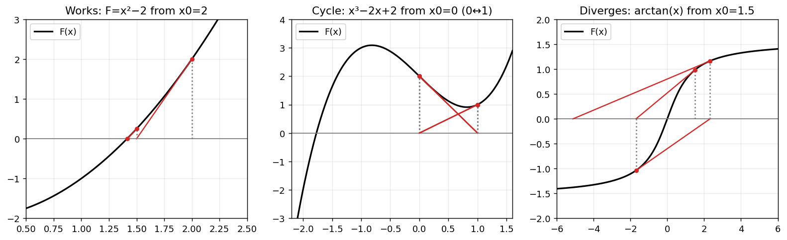

**What to look at.** Left: each red segment is a tangent line; its zero is the next iterate. Middle: for $x^3-2x+2$ started at $0$, the tangent at $0$ sends us to $1$, and the tangent at $1$ sends us back to $0$ — a **cycle**. Right: for $\arctan x$ started at $1.5$, the tangent is so flat that we overshoot further each time — **divergence**.

**Limitations to remember:** poor initial point, $F'\approx0$ (huge step), cycling, divergence. (In the notebook, 🔧 try `x0=0.5` for $x^3-2x+2$: it converges, but only after wandering to $-2.1$ first.)

> **Forward pointer.** If $F=f'$ then $p=-f'/f''$. Curvature $f''$ sets the step length: flat means a long step, steep means a short one. Gradient descent with a fixed $\alpha$ has no such information.

<details><summary><b>Check yourself</b></summary>

1. *Why does Newton for $F(x)=x^3$ converge only linearly?* Because $F'(x^{*})=0$ at the root, so the hypothesis of the quadratic-convergence argument fails ($x_{k+1}=\tfrac23x_k$).
2. *Why can Newton cycle?* The tangent line is only a local model; far from the root it can point to a place whose own tangent points back.
</details>

## 3. Systems of equations

### 3.1. From a scalar equation to a system of equations

So far, we have considered Newton's method for solving a scalar nonlinear equation:

$$
F(x)=0,\qquad F:\mathbb{R}\rightarrow\mathbb{R}.
$$

At each iteration, we approximate the nonlinear function by its tangent line and find where this linear approximation crosses zero.

The Newton iteration is:

$$
x_{k+1}=x_k-\frac{F(x_k)}{F'(x_k)}.
$$

Now, suppose that we want to solve several nonlinear equations simultaneously. We have a system:

$$
F(x)=0,\qquad F:\mathbb{R}^n\rightarrow\mathbb{R}^n,
$$

where

$$
x=
\begin{pmatrix}
x_1\\\\
x_2\\\\
\vdots\\\\
x_n
\end{pmatrix},
\qquad
F(x)=
\begin{pmatrix}
F_1(x)\\\\
F_2(x)\\\\
\vdots\\\\
F_n(x)
\end{pmatrix}.
$$

We are looking for a point $x^{*}$ at which **all the equations are satisfied simultaneously**:

$$
F_1(x^{*})=F_2(x^{*})=\cdots=F_n(x^{*})=0.
$$

The principle of Newton's method remains exactly the same:

**Approximate the nonlinear function locally by a linear function, then solve the linearized problem.**

The difference is that we now work with vectors and matrices instead of scalars.

### 3.2. The Jacobian: the multidimensional derivative

For a scalar function, the derivative $F'(x)$ tells us how the function changes when we move along the input axis.

For a vector-valued function, we need to describe how *each output component* changes with respect to *each input variable*.

This information is collected in the **Jacobian matrix**:

$$
J(x)=
\begin{pmatrix}
\frac{\partial F_1}{\partial x_1}
&
\frac{\partial F_1}{\partial x_2}
&
\cdots
&
\frac{\partial F_1}{\partial x_n}
\\\\
\frac{\partial F_2}{\partial x_1}
&
\frac{\partial F_2}{\partial x_2}
&
\cdots
&
\frac{\partial F_2}{\partial x_n}
\\\\
\vdots & \vdots & \ddots & \vdots\\\\
\frac{\partial F_n}{\partial x_1}
&
\frac{\partial F_n}{\partial x_2}
&
\cdots
&
\frac{\partial F_n}{\partial x_n}
\end{pmatrix}.
$$

The Jacobian is the matrix representation of the derivative of $F$.

Its geometric meaning is important: **the Jacobian describes the best local linear approximation of how the entire vector $F(x)$ changes when we move away from $x$.**

For a small displacement vector $p$, we have the first-order Taylor approximation:

$$
F(x+p)\approx F(x)+J(x)p.
$$

Notice the correspondence with the scalar case:

| Scalar Newton | Multidimensional Newton |
|---|---|
| $F'(x)$ | $J(x)$ |
| Scalar displacement $p$ | Vector displacement $p$ |
| $F(x+p)\approx F(x)+F'(x)p$ | $F(x+p)\approx F(x)+J(x)p$ |

### 3.3. Deriving the Newton iteration

We want to find a displacement $p_k$ that takes us from the current point $x_k$ toward a solution.

At the next point, we want:

$$
F(x_k+p_k)=0.
$$

However, solving this nonlinear equation directly is the original problem. Instead, we replace it with its local linear approximation:

$$
F(x_k+p_k)\approx F(x_k)+J(x_k)p_k.
$$

We now impose the condition that this approximation should be zero:

$$
F(x_k)+J(x_k)p_k=0.
$$

Rearranging gives:

$$
\boxed{J(x_k)p_k=-F(x_k)}
$$

This is the **Newton linear system**.

Once we have solved it, we update our current point:

$$
\boxed{x_{k+1}=x_k+p_k}
$$

Therefore, each Newton iteration consists of two operations:

1. Solve the linear system $J(x_k)p_k=-F(x_k)$ to find the correction vector.
2. Update the current point using $x_{k+1}=x_k+p_k$.

**A practical implementation does not explicitly calculate $J(x_k)^{-1}$.** It solves the linear system directly.
 <!-- typically using LU or QR factorization. Cholesky is appropriate only when the matrix has the required symmetric positive-definite structure. -->

### 3.4. Geometric interpretation in two dimensions

Consider a system with two equations and two unknowns:

$$
F(x,y)=
\begin{pmatrix}
F_1(x,y)\\\\
F_2(x,y)
\end{pmatrix} =
\begin{pmatrix}
0\\\\
0
\end{pmatrix}.
$$

Each equation defines a curve in the $(x,y)$ plane:

- $F_1(x,y)=0$ defines the first curve (level set for all $(x, y)$ making $F_1(x,y)=0$).
- $F_2(x,y)=0$ defines the second curve (level set for all $(x, y)$ making $F_2(x,y)=0$) .

A solution of the system is an **intersection point of these two curves**.

At the current point $(x_k,y_k)$, Newton's method constructs a local linear approximation of both equations. It then finds the point where these two linear approximations are simultaneously zero.

That intersection determines the next Newton iterate.

The process is repeated until the two equations are approximately satisfied.

In other words:

- The original problem is to find the intersection of two nonlinear curves.
- Newton's method replaces the curves locally by their tangent-line approximations.
- The intersection of these local approximations gives the next iterate.

This is the geometric meaning of solving the Newton linear system.

### 3.5. Numerical example: intersection of a circle and a hyperbola

Consider the following system:

$$
\begin{cases}
x^2+y^2-4=0\\\\
xy-1=0
\end{cases}
$$

The first equation represents a circle centered at the origin with radius $2$:

$$
x^2+y^2=4.
$$

The second equation represents a hyperbola:

$$
xy=1.
$$

We want to find their intersection points.

Define:

$$
F(x,y)=
\begin{pmatrix}
x^2+y^2-4\\\\
xy-1
\end{pmatrix}.
$$

#### Step 1: Calculate the Jacobian

The Jacobian is:

$$
J(x,y)=
\begin{pmatrix}
\frac{\partial F_1}{\partial x} &
\frac{\partial F_1}{\partial y}\\\\
\frac{\partial F_2}{\partial x} &
\frac{\partial F_2}{\partial y}
\end{pmatrix}.
$$

Calculating the partial derivatives gives:

$$
\boxed{
J(x,y)=
\begin{pmatrix}
2x & 2y\\\\
y & x
\end{pmatrix}
}
$$

#### Step 2: Write the Newton system

At iteration $k$, let the current point be:

$$
(x_k,y_k).
$$

The Newton correction is obtained by solving:

$$
\begin{pmatrix}
2x_k & 2y_k\\\\
y_k & x_k
\end{pmatrix}
\begin{pmatrix}
p_1\\\\
p_2
\end{pmatrix}
=
-
\begin{pmatrix}
x_k^2+y_k^2-4\\\\
x_ky_k-1
\end{pmatrix}.
$$

After solving this system, we update:

$$
\begin{cases}
x_{k+1}=x_k+p_1\\\\
y_{k+1}=y_k+p_2
\end{cases}
$$

#### Step 3: Iterations

We start from:

$$
(x_0,y_0)=(2,0.8).
$$

First, evaluate the function:

$$
F(2,0.8)=
\begin{pmatrix}
2^2+0.8^2-4\\\\
2(0.8)-1
\end{pmatrix}
=
\begin{pmatrix}
0.64\\\\
0.60
\end{pmatrix}.
$$

Next, evaluate the Jacobian:

$$
J(2,0.8)=
\begin{pmatrix}
4 & 1.6\\\\
0.8 & 2
\end{pmatrix}.
$$

The Newton system is:

$$
\begin{pmatrix}
4 & 1.6\\\\
0.8 & 2
\end{pmatrix}
\begin{pmatrix}
p_1\\\\
p_2
\end{pmatrix}
=
\begin{pmatrix}
-0.64\\\\
-0.60
\end{pmatrix}.
$$

Solving this system gives:

$$
p=
\begin{pmatrix}
-0.047619\\\\
-0.280952
\end{pmatrix}.
$$

Therefore:

$$
\begin{aligned}
x_1&=2-0.047619=1.952381,\\\\
y_1&=0.8-0.280952=0.519048.
\end{aligned}
$$

Thus:

$$
\boxed{(x_1,y_1)\approx(1.952381,0.519048)}
$$

Notice that the correction is a vector: it changes both coordinates simultaneously.

**Continue the iterations**

Repeating the same procedure gives:

| Iteration $k$ | Current point $(x_k,y_k)$ | Residual norm $\|F(x_k)\|_2$ |
|---:|---:|---:|
| 0 | $(2.000000,\;0.800000)$ | $8.77\times10^{-1}$ |
| 1 | $(1.952381,\;0.519048)$ | $8.23\times10^{-2}$ |
| 2 | $(1.931964,\;0.517623)$ | $4.20\times10^{-4}$ |
| 3 | $(1.931852,\;0.517638)$ | $1.30\times10^{-8}$ |

We can see that the residual decreases rapidly. After only three Newton updates, we are already extremely close to a solution.

The approximate solution is:

$$
\boxed{(x^{*},y^{*})\approx(1.931852,\;0.517638)}
$$

For this simple example, the exact positive solution can also be obtained algebraically:

$$
x^2+y^2=4,\qquad xy=1.
$$

Adding and subtracting the equations after using $(x+y)^2$ and $(x-y)^2$ gives:

$$
(x+y)^2=6,\qquad (x-y)^2=2.
$$

Hence, in the first quadrant:

$$
x^{*}=\frac{\sqrt{6}+\sqrt{2}}{2}\approx 1.93185165,
\qquad
y^{*}=\frac{\sqrt{6}-\sqrt{2}}{2}\approx 0.51763805.
$$


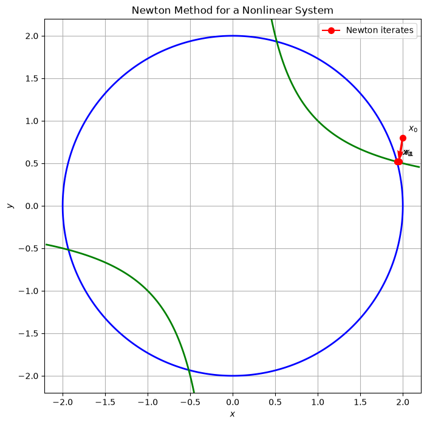
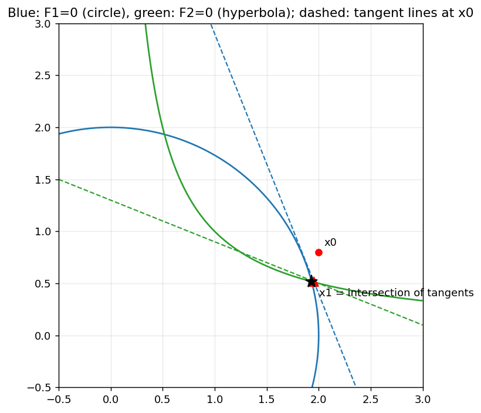

**What to look at.** Blue is the curve $F_1=0$, green is $F_2=0$. The dashed lines are their **tangent lines at $x_0$**. The next iterate $x_1$ is exactly where the two tangent lines cross. Each Newton step replaces two curves by two lines and intersects them.

> **Forward pointer for §7.** When $F=\nabla f$, the curves are $\partial_1f=0$ and $\partial_2f=0$. They intersect at **every** stationary point: minima, maxima and saddles alike. Root finding cannot tell them apart.

<details><summary><b>Check yourself</b></summary>

*What does $J(x_k)p=-F(x_k)$ say in words?* "Find the displacement whose linear effect, $Jp$, cancels the current residual $F(x_k)$."
</details>

---
# Part II — Newton's method for optimization

## 4. Optimization as root finding

At a local minimizer of a differentiable function $f$, the first-order necessary condition is:

$$
\nabla f(x^{*})=0.
$$

Points satisfying this condition are called **stationary points**. It is a necessary condition for a minimizer, not a definition of one.

We can therefore transform optimization into a root-finding problem by defining:

$$
F(x)=\nabla f(x).
$$

The Jacobian of this new function is:

$$
J_F(x)=\nabla^2f(x)=H(x).
$$

The **Hessian is the Jacobian of the gradient**.

Applying Newton's root-finding method gives:

$$
\boxed{
H(x_k)p_k=-\nabla f(x_k),
\qquad
x_{k+1}=x_k+p_k.
}
$$

**Important property.** The Hessian is symmetric (assuming $f$ is twice continuously differentiable). A general Jacobian need not be symmetric. This symmetry allows us to interpret Newton's step through a scalar quadratic model, as we will see in the next section.

### 4.1. Gradient descent as a simplified Newton-like method

Recall the gradient descent update:

$$
x_{k+1}=x_k-\alpha\nabla f(x_k).
$$

We can rewrite it as:

$$
x_{k+1}
=
x_k-
\left(\frac{1}{\alpha}I\right)^{-1}
\nabla f(x_k).
$$

Compare this with Newton's update:

$$
x_{k+1}=x_k-H_k^{-1}\nabla f(x_k).
$$

Gradient descent can be interpreted as replacing the Hessian by a scalar multiple of the identity:

$$
H_k\approx\frac{1}{\alpha}I.
$$

This approximation treats all directions as having the same curvature.

**The key difference:**

- Gradient descent uses one scalar step size for every direction.
- Newton uses the Hessian to account for the different curvatures of different directions.

Gradient descent therefore discards the directional curvature information contained in the Hessian. This difference will explain the zigzagging behavior of gradient descent.

---

## 5. Newton's method from the second-order model

### 5.1 The local quadratic approximation

The Hessian is not simply a matrix that appears in Newton's formula. It describes how the function curves around the current point.

To understand its role, consider the second-order Taylor approximation of $f$ around $x_k$:

$$
\boxed{
m_k(p)=
f(x_k)+g_k^Tp+\frac12p^TH_kp
}
$$

where:

- $g_k=\nabla f(x_k)$ is the gradient.
- $H_k=\nabla^2f(x_k)$ is the Hessian.
- $p$ is a displacement from the current point.

The three terms have different meanings:

| Term | Meaning |
|---|---|
| $f(x_k)$ | Current function value |
| $g_k^Tp$ | First-order change: slope |
| $\frac12p^TH_kp$ | Second-order change: curvature |

The model combines the local slope and curvature to predict how the function changes when we move from $x_k$ by $p$.

### 5.2 Finding the minimum of the quadratic model

Newton's idea is to minimize this local quadratic model rather than directly minimizing the original nonlinear function.

Differentiate with respect to $p$:

$$
\nabla_p m_k(p)=g_k+H_kp.
$$

Setting the gradient to zero gives:

$$
g_k+H_kp_k=0.
$$

Therefore:

$$
\boxed{H_kp_k=-g_k.}
$$

This is exactly the Newton equation obtained from the root-finding interpretation.

**Important distinction.** Setting the gradient to zero finds a stationary point of the quadratic model. It is a minimum only if $H_k\succ0$.

If the Hessian is indefinite, the stationary point may be a saddle. If it is negative definite, it is a maximum.

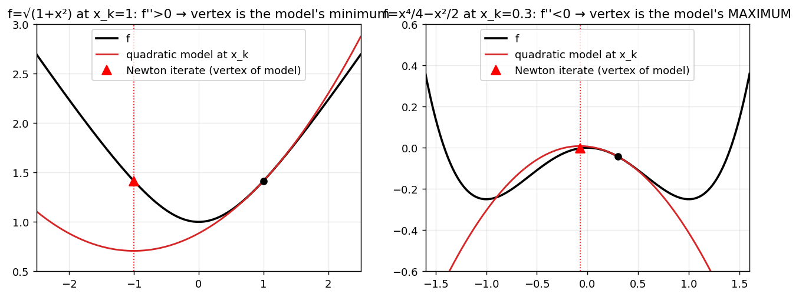

**What to look at.**

- Left: for $f=\sqrt{1+x^2}$ at $x_k=1$, $f''>0$. The quadratic model opens upward, and its stationary point is a minimum.
- Right: for $f=x^4/4-x^2/2$ at $x_k=0.3$, we have $f''(0.3)=-0.73<0$. The quadratic model opens downward, and its stationary point is a maximum. Newton moves to approximately $-0.074$, toward the local maximum of $f$ at $0$, away from the minimizers $x=\pm1$.

<!-- ### 5.3 The important connection: a quadratic function is its own second-order model

Consider the quadratic function:

$$
f(x)=\frac12(x-x^{*})^TA(x-x^{*}),
$$

where $A$ is symmetric positive definite.

Its gradient is:

$$
\nabla f(x)=A(x-x^{*}).
$$

Its Hessian is:

$$
\boxed{H(x)=A.}
$$

Notice that the Hessian is constant. There is no variation in curvature from one point to another.

Now consider the second-order Taylor expansion around any point $x_k$:

$$
f(x_k+p)
=
f(x_k)+\nabla f(x_k)^Tp
+\frac12p^TAp.
$$

This is an exact equality, not an approximation.

**This is a special property of quadratic functions: their second-order Taylor model reproduces the original function exactly.**

For a general nonlinear function, the quadratic model is only a local approximation. For a quadratic function, it describes the entire objective.

This is why the quadratic case is so useful for understanding Newton's method: we can study the effect of curvature without worrying about approximation errors.

### 5.4 What each interpretation teaches us

| View | What it explains |
|---|---|
| Root finding | Why Newton solves $H_kp_k=-g_k$ |
| Quadratic model | Why the Hessian represents local curvature |
| Exact quadratic | Why Newton can reach the minimizer in one step |

Why do the root-finding and quadratic-model derivations coincide? Because the Hessian is symmetric. For a general vector function with a non-symmetric Jacobian, there is not necessarily a scalar objective whose quadratic model is being minimized.

<details><summary><b>Check yourself</b></summary>

For $f(x)=-x^2$, where does Newton go and why is that not what we want?

Newton goes to $x=0$ in one step. This is the global maximizer, not a minimizer. Newton finds stationary points, and the negative Hessian indicates that the stationary point is a maximum.

</details>

---
 -->
## 6. Why does Newton correct the gradient direction?

**Central question: Why can the gradient point almost perpendicular to the direction toward the minimizer?**

We will use a quadratic function to understand the answer.

### 6.1 The gradient is a curvature-weighted displacement

Consider:

$$
f(x)=\frac12(x-x^{*})^TA(x-x^{*}),
$$

where $A$ is symmetric positive definite.

We know that:

$$
\nabla f(x)=A(x-x^{*}).
$$

Let:

$$
e=x-x^{*}.
$$

Then:

$$
\boxed{g=Ae.}
$$

This equation is the key to understanding the difference between gradient descent and Newton's method.

The vector $e$ describes our actual displacement from the minimizer. But the gradient is not simply this displacement: it is the displacement after being transformed by the Hessian.

In other words:

$$
\underbrace{x-x^{*}}_{\text{actual displacement}}
\quad\xrightarrow{\ A\ }\quad
\underbrace{\nabla f(x)}_{\text{gradient}}.
$$

The Hessian changes the relative contributions of different directions according to their curvature.

**Intuition.** The gradient tells us how steep the function is, but its direction is also influenced by how rapidly the function curves in different directions.

This is why the negative gradient does not necessarily point directly toward the minimizer.

### 6.2 A numerical example: the gradient can be misleading

At the point:

$$
x_0=(0.6,-0.4),
$$

we have:

$$
g_0=Ax_0=(10.5,9.5).
$$

The direction toward the minimizer $x^{*}=0$ is:

$$
d^{*}=x^{*}-x_0=(-0.6,0.4).
$$

Gradient descent chooses the negative gradient direction:

$$
d_{GD}=-g_0=(-10.5,-9.5).
$$

The angle between these two directions is:

$$
\cos\theta=
\frac{d_{GD}^Td^{*}}
{\|d_{GD}\|\|d^{*}\|}.
$$

Substituting:

$$
\cos\theta=
\frac{(-10.5)(-0.6)+(-9.5)(0.4)}
{\sqrt{10.5^2+9.5^2}\sqrt{0.6^2+0.4^2}}.
$$

Therefore:

$$
\boxed{\theta\approx75.8^\circ.}
$$

The negative gradient points almost perpendicular to the direction toward the minimizer!

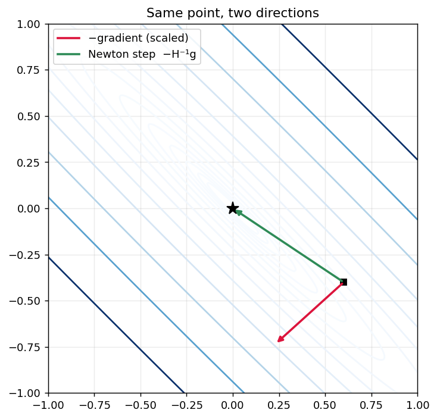

**What to look at.**

- The red arrow (negative gradient) points almost across the valley.
- The green arrow (Newton direction) points directly toward the minimizer.

The steepest descent direction is the direction of maximum instantaneous decrease. It is not necessarily the direction that minimizes the distance to the solution.

### 6.3 Why does curvature distort the gradient?

To understand the mechanism, consider the eigenvectors of the Hessian.

Since $A$ is symmetric positive definite, it has an eigendecomposition:

$$
A=Q\Lambda Q^T,
$$

where:

$$
\Lambda=
\begin{pmatrix}
\lambda_1&0\\\\
0&\lambda_2
\end{pmatrix}.
$$

The eigenvectors $q_1,q_2$ define the principal directions of curvature:

- A large eigenvalue means high curvature.
- A small eigenvalue means low curvature.

The following figure connects these directions to the shape of the quadratic function.

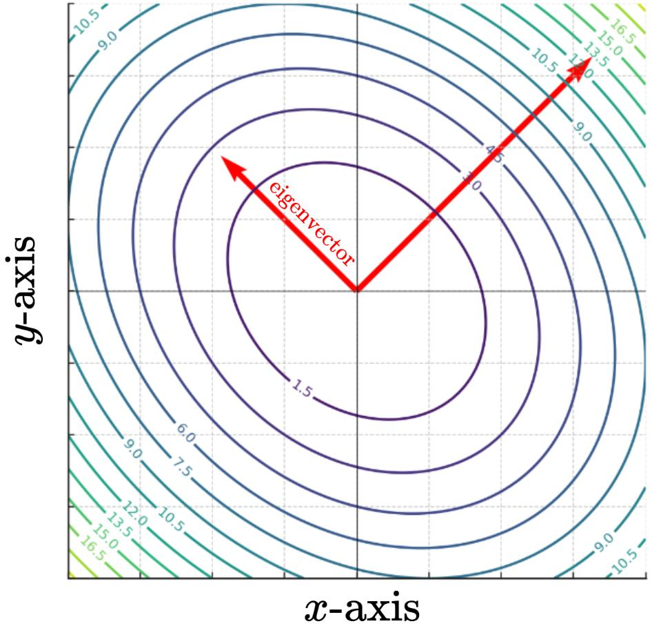

**What to look at.** The narrow direction of the ellipse corresponds to high curvature, while the long direction corresponds to low curvature. The eigenvectors identify these two directions.

Express the displacement in these directions:

$$
e=c_1q_1+c_2q_2.
$$

The gradient becomes:

$$
g=Ae=c_1Aq_1+c_2Aq_2
=\lambda_1c_1q_1+\lambda_2c_2q_2.
$$

Compare the two vectors:

| Direction | Displacement component | Gradient component |
|---|---|---|
| $q_1$ | $c_1$ | $\lambda_1c_1$ |
| $q_2$ | $c_2$ | $\lambda_2c_2$ |

Suppose $\lambda_1$ is much larger than $\lambda_2$.

Even if the displacement has comparable components along both directions, the gradient will be dominated by the high-curvature direction.

**The Hessian amplifies the high-curvature components and gives less weight to the low-curvature components.**

Consequently, the gradient can point in a very different direction from the actual displacement.

**Eigenvectors and Eigenvalues**
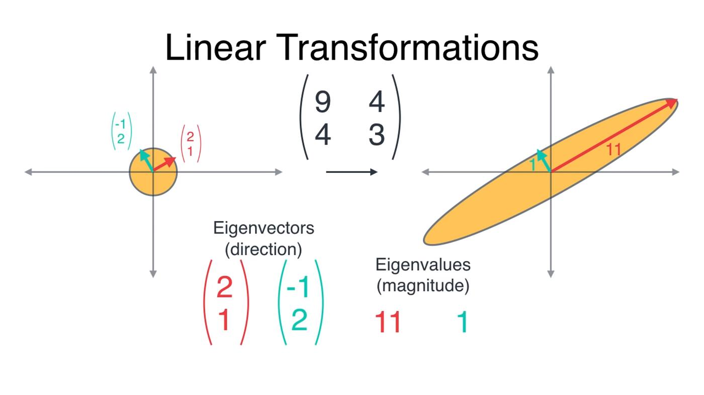

Eigenvectors describe the directions along which the transformation acts by pure scaling.

Eigenvalues describe the scaling factors along those directions.

### 6.4 Newton's method: undoing the curvature distortion

Newton's method computes:

$$
p_N=-A^{-1}g.
$$

Substituting $g=Ae$:

$$
\begin{aligned}
p_N
&=-A^{-1}Ae\\\\
&=-e\\\\
&=x^{*}-x.
\end{aligned}
$$

Therefore:

$$
\boxed{p_N=x^{*}-x.}
$$

Newton recovers the actual direction toward the minimizer.

In the eigenvector coordinates:

$$
\begin{aligned}
A^{-1}g
&=
\frac{\lambda_1c_1}{\lambda_1}q_1
+
\frac{\lambda_2c_2}{\lambda_2}q_2\\\\
&=c_1q_1+c_2q_2\\\\
&=e.
\end{aligned}
$$

The inverse Hessian removes the unequal curvature weighting introduced by the Hessian.

**Important distinction:** $A^{-1}$ does not simply rotate the gradient. It rescales its components along the principal curvature directions. This rescaling changes the overall direction of the vector.


**What to look at.** The displacement is transformed by $A$ into the gradient. The high-curvature component becomes relatively larger. Applying $A^{-1}$ reverses this unequal scaling and recovers the original displacement.

For our numerical example:

$$
p_N=-A^{-1}g_0=(-0.6,0.4).
$$

Newton points exactly toward the minimizer.

**The central interpretation:**

$$
\boxed{
\text{Displacement}
\xrightarrow{\ H\ }
\text{Gradient}
\xrightarrow{\ H^{-1}\ }
\text{Displacement}
}
$$

The gradient is a curvature-weighted displacement. Newton uses the inverse Hessian to correct that weighting.

### 6.5 Why does gradient descent zigzag?

Now we can understand the behavior of gradient descent on an elongated quadratic valley.

Consider again:

$$
f(x)=\frac12x^TAx,
$$

with minimizer $x^{*}=0$.

A gradient descent step gives:

$$
x_{k+1}=x_k-\alpha Ax_k.
$$

Therefore:

$$
\boxed{x_{k+1}=(I-\alpha A)x_k.}
$$

In the eigenvector coordinates, each component evolves independently:

$$
\boxed{
c_i^{(k+1)}
=
(1-\alpha\lambda_i)c_i^{(k)}.
}
$$

Each direction has its own contraction factor.

- **Stiff modes (large $\lambda_i$):** The factor can be negative, causing the component to change sign at every iteration. This produces overshooting across the narrow valley.
- **Soft modes (small $\lambda_i$):** The factor is positive and close to one. The component decreases very slowly.

Thus, gradient descent faces two conflicting requirements:

- A small step size is needed to avoid overshooting in high-curvature directions.
- A large step size is needed to make progress in low-curvature directions.

A single scalar step size cannot handle both directions efficiently.

<!-- For convergence, we require:

$$
0<\alpha<\frac{2}{\lambda_{\max}}.
$$

The best fixed step size for the worst-case contraction factor is:

$$
\alpha^{*}=\frac{2}{\lambda_{\min}+\lambda_{\max}}.
$$

The corresponding worst-case factor is:

$$
\rho=\frac{\kappa-1}{\kappa+1},
\qquad
\kappa=\frac{\lambda_{\max}}{\lambda_{\min}}.
$$

For our ellipse, $\kappa=100$:

$$
\rho=\frac{99}{101}\approx0.9802.
$$

The stiff mode has factor $-0.9802$, while the soft mode has factor $+0.9802$.

Reducing the error by a factor of $10^{-6}$ can therefore require approximately:

$$
\frac{\ln(10^{-6})}{\ln(99/101)}
\approx691
$$

iterations in the worst case.

 -->

**What to look at.** Gradient descent repeatedly crosses the narrow valley while making slow progress along its long axis. Newton compensates for the different curvatures and, for this quadratic function, reaches the minimizer directly.

<!-- ### 6.6 The eigenmode explanation

The trajectory figure shows the geometric behavior. The eigenmode figure explains it algebraically.

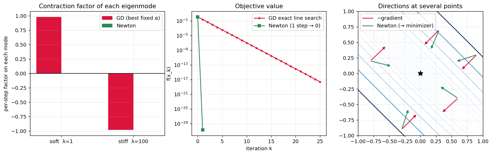

**What to look at.**

- Left: GD's two eigenmode factors are approximately $-0.98$ and $+0.98$, while Newton's are both zero.
- Middle: GD decreases the objective geometrically, whereas Newton reaches the minimum in one step.
- Right: the negative gradient and Newton directions differ strongly, and the Newton direction points directly toward the minimizer.

Newton applies the inverse Hessian:

$$
p_N=-A^{-1}Ax=-x.
$$

Thus:

$$
x_{k+1}=x_k+p_N=0.
$$

In eigenvector coordinates, Newton divides each gradient component by its corresponding eigenvalue:

$$
\frac{\lambda_i c_i}{\lambda_i}=c_i.
$$

Every curvature mode is corrected independently. There is no slow mode and no overshooting mode.

**For a positive-definite quadratic function, Newton reaches the minimizer in one step, regardless of the condition number or orientation of the ellipse.**

This is the fundamental reason Newton's method avoids the zigzagging behavior of gradient descent on quadratic objectives.

> **Playground (notebook, Part II §6).** Change `kappa` and `theta`. With `kappa=2`, gradient descent is relatively fast; with `kappa=1000`, it becomes very slow. With `theta=0` (no rotation), GD still crawls along the soft direction, while Newton still reaches the minimizer in one step.
 -->

<!-- ### 6.7 (Optional) Newton is steepest descent in the Hessian metric

"Steepest" depends on how we measure distance.

Using the Hessian-induced norm:

$$
\|p\|_H^2=p^THp,
$$

consider:

$$
\min_p g^Tp
\qquad
\text{subject to}
\qquad
p^THp\leq1.
$$

The Lagrangian is:

$$
\mathcal L(p,\mu)=g^Tp+\mu(p^THp-1).
$$

Its first-order condition gives:

$$
g+2\mu Hp=0.
$$

Therefore:

$$
p\propto-H^{-1}g.
$$

Newton is thus the steepest descent direction when distance is measured using the Hessian metric rather than the ordinary Euclidean metric.

In the coordinates $y=H^{1/2}x$, the quadratic level sets become spheres. This also explains **affine invariance**: under an invertible linear change of variables $x=Ty$, Newton's iterates transform consistently, while ordinary gradient descent generally depends on how the variables are scaled.

<details><summary><b>Check yourself</b></summary>

1. Why does exact line search on a quadratic function give $g_{k+1}^Tg_k=0$? The new gradient is orthogonal to the previous gradient.
2. Why does a larger condition number slow gradient descent? The worst-case factor $(\kappa-1)/(\kappa+1)$ approaches one.
3. If $A=cI$, how many steps does gradient descent need with $\alpha=1/c$? One, because $I-\alpha A=0$.
4. Why does Newton reach the minimum of a positive-definite quadratic in one step? Its Hessian is constant, and the Newton step exactly cancels the displacement from the minimizer.

</details>

--- -->

## 7. Does Newton find a minimum?

Newton's method finds stationary points. It does not automatically distinguish minima from maxima or saddle points.

At a stationary point $x^{*}$, the Hessian provides the second-order classification:

| Hessian at $x^{*}$ | Classification |
|---|---|
| $H(x^{*})\succ0$ | Strict local minimum |
| $H(x^{*})\prec0$ | Strict local maximum |
| $H(x^{*})$ indefinite | Saddle point |
| $H(x^{*})\succeq0$ but singular | Inconclusive |

Newton jumps to the stationary point of the local quadratic model, whatever its type.

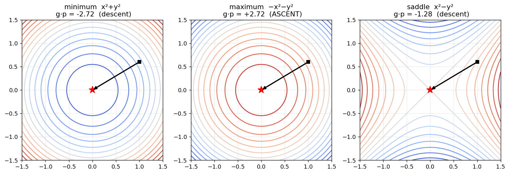

**What to look at.** From the same start $(1,0.6)$, one Newton step lands exactly on the stationary point in all three cases: the minimum of $x^2+y^2$, the maximum of $-x^2-y^2$, and the saddle of $x^2-y^2$. The titles show $g^Tp$: negative means descent, positive means ascent.

### 7.1 Descent property

The directional derivative along the Newton step is:

$$
g_k^Tp_k=-g_k^TH_k^{-1}g_k.
$$

- If $H_k\succ0$, then $H_k^{-1}\succ0$ and $g_k^Tp_k<0$: **Newton is a descent direction**.
- Otherwise, the sign is not controlled and the step can point uphill.

**Example.** For $f=x^2-y^2$ at $(1,2)$:

$$
g=(2,-4),\qquad H=\operatorname{diag}(2,-2).
$$

The Newton step is:

$$
p=(-1,-2).
$$

Therefore:

$$
g^Tp=(-2)+8=+6>0.
$$

The Newton step is an **ascent** direction, so no line search along it can succeed.

This is not an independent failure. It is the same loss of positive definiteness seen through the sign of $g^Tp$.

### 7.2 Singular and near-singular Hessians

If $H_k$ is singular, the system:

$$
H_kp_k=-g_k
$$

may have no solution or infinitely many solutions.

If $\lambda_{\min}(H_k)>0$ is very small, then the inverse Hessian can amplify the corresponding gradient component substantially. The resulting Newton step may be enormous.

This is another reason why an undamped Newton step can be unreliable far from a minimizer.

<!-- ### 7.3 Local quadratic convergence

**Theorem.** Let $f$ be $C^2$, $\nabla f(x^{*})=0$, $H(x^{*})\succ0$, and suppose $H$ is Lipschitz continuous near $x^{*}$ with constant $L$. Then, for $x_0$ sufficiently close to $x^{*}$, the Newton iterates converge to $x^{*}$ and:

$$
\boxed{
\|x_{k+1}-x^{*}\|
\leq C\|x_k-x^{*}\|^2.
}
$$

**Optional proof.** Let $e_k=x_k-x^{*}$. By the fundamental theorem of calculus:

$$
\nabla f(x_k)
=
\int_0^1H(x^{*}+te_k)e_k\,dt.
$$

Using the Newton update:

$$
e_{k+1}
=
H(x_k)^{-1}
\int_0^1
\left[H(x_k)-H(x^{*}+te_k)\right]e_k\,dt.
$$

Since $H$ is Lipschitz continuous:

$$
\boxed{
\|e_{k+1}\|
\leq
\frac{L}{2}\|H(x_k)^{-1}\|\|e_k\|^2.
}
$$

This is the root-finding proof applied to $F=\nabla f$.

$\square$

**What the hypotheses are for.**

- $H(x^{*})\succ0$ keeps the Hessian invertible near the solution.
- Lipschitz continuity of $H$ controls the error of the local quadratic model.
- "Close enough" is essential: the theorem is **local**.

The next part of the lecture addresses what happens outside this local region.

<details><summary><b>Check yourself</b></summary>

Newton converges in one step on every strictly convex quadratic. Which hypothesis makes the quadratic-convergence bound give $e_{k+1}=0$?

Because $H\equiv A$ is constant, its Lipschitz constant is $L=0$.

</details>

---

<!-- # Part II — Newton's method for optimization

## 4. Optimization as root finding

At a local minimizer of a differentiable $f$ the first-order necessary condition holds:
$$\nabla f(x^{*})=0 .$$
Points satisfying it are called **stationary points**. It is a *necessary* condition for a minimizer, not a definition of one. Take $F=\nabla f$. Then
$$J_F(x)=\nabla^2f(x)=H(x),$$
the **Hessian is the Jacobian of the gradient**. Newton's root-finding step becomes
$$\boxed{H(x_k)\,p_k=-\nabla f(x_k),\qquad x_{k+1}=x_k+p_k.}$$

**Important property.** $H$ is **symmetric**. A general Jacobian is not. This symmetry is the reason an optimization interpretation exists (§5).

### Gradient descent is Newton with a crude Jacobian

Write the gradient descent update as
$$x_{k+1}=x_k-\alpha\nabla f(x_k)=x_k-\bigl(\tfrac1\alpha I\bigr)^{-1}\nabla f(x_k).$$
Compare with Newton, $x_{k+1}=x_k-H_k^{-1}\nabla f(x_k)$. Gradient descent is Newton's method where the Jacobian $H_k$ has been replaced by the scalar matrix $\tfrac1\alpha I$. **GD discards all curvature structure.** The next sections show that this is exactly the cause of the zigzag.

**Direct comparison at one point.** At $x_0=(0.6,-0.4)$ we have $g_0=Ax_0=(10.5,\ 9.5)$. The Newton step is $p=-A^{-1}g_0=(-0.6,\ 0.4)=x^{*}-x_0$. The negative gradient makes an angle of **75.8°** with the direction to the minimizer.


**What to look at.** From the same point, the red arrow (negative gradient) points almost across the valley. The green arrow (Newton) points straight at the minimizer.

## 5. Newton from the second-order model

**Goal.** Obtain the same step a second way, and see what the first derivation could not tell us.

**Idea.** Approximate $f$ near $x_k$ by a quadratic and jump to the stationary point of that quadratic.

**Derivation.** The second-order Taylor model is
$$m_k(p)=f(x_k)+g_k^Tp+\tfrac12p^TH_kp.$$
Its gradient with respect to $p$ is $g_k+H_kp$. Setting it to zero gives $H_kp=-g_k$: **the same equation**.

**Careful.** Setting $\nabla_pm_k=0$ finds a **stationary point of the model**. It is a *minimizer* of the model only if $H_k\succ0$. If $H_k$ has a negative eigenvalue, the model is a saddle or a maximum in that direction.


**What to look at.** Left: for $f=\sqrt{1+x^2}$ at $x_k=1$, $f''>0$ and the red parabola opens upward, so its vertex is a minimum. Right: for $f=x^4/4-x^2/2$ at $x_k=0.3$ we have $f''(0.3)=-0.73<0$. The parabola opens **downward**; its vertex is a **maximum** of the model. Newton moves to $-0.074$, toward the local maximum of $f$ at $0$, away from the minimizers $x=\pm1$.

**What each derivation teaches.**

| View | Tells you | Cannot tell you |
|---|---|---|
| Root finding | why the equation has this *form* | whether you are heading to a min or a max (replacing $f$ by $-f$ gives identical iterates) |
| Quadratic model | what is being minimized, and where the **sign of the curvature** enters | — |

Why do the two coincide? Because $\nabla^2f$ is symmetric. For a general $F$ with a non-symmetric Jacobian there is no objective whose model is being minimized.

<details><summary><b>Check yourself</b></summary>

*For $f(x)=-x^2$, where does Newton go and why is that not what we want?* One step to $x=0$, the global **maximizer**. Newton finds stationary points, and $f''<0$ makes the stationary point a maximum.
</details>

## 6. Why Newton avoids the zigzag

**Goal.** Answer the question "why does the Newton direction lead to the minimum?" with three independent arguments on the quadratic $f=\tfrac12x^TAx$ (so $x^{*}=0$, and $H=A$).

### 6.1 The gradient is a distorted error vector

Let $e=x-x^{*}$. Then $\nabla f(x)=A(x-x^{*})=Ae$. The direction we *want* is the one pointing at the minimizer, $-e$. The steepest-descent direction is $-Ae$, the error **after being multiplied by $A$**. These agree only if $A$ is a multiple of $I$ (circular level sets) or $e$ happens to be an eigenvector.

Newton applies $A^{-1}$ to undo the distortion:
$$p=-A^{-1}\nabla f(x)=-A^{-1}Ae=-e=x^{*}-x.$$
**On a quadratic, the Newton step is exactly the vector from the current point to the minimizer.** This is the cleanest answer, and the Taylor argument is a consequence of it.

### 6.2 The eigenmode picture (the source of the zigzag)

Let $A=\sum_i\lambda_iv_iv_i^T$ and expand the error as $e=\sum_ic_iv_i$. A gradient step with step size $\alpha$ gives
$$e_{k+1}=(I-\alpha A)e_k\quad\Longrightarrow\quad c_i^{(k+1)}=(1-\alpha\lambda_i)\,c_i^{(k)} .$$
So each mode is multiplied by its own factor $1-\alpha\lambda_i$:

- **Stiff modes** (large $\lambda_i$): the factor can be negative with magnitude near 1. The mode overshoots and **flips sign every step**. This is the zigzag.
- **Soft modes** (small $\lambda_i$): the factor is positive and close to 1. The mode **crawls**.

Stability requires $\alpha<2/\lambda_{\max}$. The best fixed step $\alpha=2/(\lambda_{\min}+\lambda_{\max})$ balances the two extremes, and the worst-case factor is
$$\frac{\kappa-1}{\kappa+1}.$$
For our ellipse this is $99/101=0.9802$: the stiff mode has factor $-0.9802$ and the soft mode $+0.9802$. Reducing the error by $10^{-6}$ would take up to $\ln10^{-6}/\ln(99/101)\approx691$ iterations in the worst case.

**Newton divides mode $i$ by $\lambda_i$** (it applies $A^{-1}$), so the factor is $1-\lambda_i\cdot\frac1{\lambda_i}=0$ for every mode. No mode is stiff or soft, so nothing can zigzag.


**What to look at.** Left: GD's two factors are $\pm0.98$, Newton's are $0$. Middle: $f(x_k)$ decreases geometrically for GD (linear convergence on a log scale) and drops to zero after one Newton step. Right: at several points the red (negative gradient) and green (Newton) arrows differ strongly, and only the green one aims at the minimizer.

> 🔧 **Playground (notebook, Part II §6).** Change `kappa` and `theta`. With `kappa=2` GD is fast; with `kappa=1000` it is hopeless. With `theta=0` (not rotated) GD still crawls, and Newton still needs exactly one step.

### 6.3 *(optional)* Newton is steepest descent in the Hessian metric

"Steepest" depends on how you measure length. With the norm $\lVert p\rVert_H^2=p^THp$:
$$\min_p\ g^Tp\ \text{ s.t. }\ p^THp\le1\quad\Longrightarrow\quad g+2\mu Hp=0\ \Longrightarrow\ p\propto-H^{-1}g .$$
In the coordinates $y=H^{1/2}x$ the level sets become spheres, where gradient descent *would* go straight to the minimum. This also explains **affine invariance**: if $x=Ty$ with $T$ invertible, Newton iterates transform as $x_k=Ty_k$, while gradient descent does not have this property (it depends on how variables are scaled).

<details><summary><b>Check yourself</b></summary>

1. *What does exact line search guarantee about $g_{k+1}^Tg_k$?* It is zero (orthogonal gradients).
2. *Why does a bigger $\kappa$ slow GD?* The worst-case factor $(\kappa-1)/(\kappa+1)$ approaches 1.
3. *If $A=cI$, how many steps does GD (with the right $\alpha$) need?* One: $I-\frac1cA=0$.
</details>

## 7. Does Newton find a minimum?

**Goal.** Know exactly what Newton guarantees and what it does not.

At a stationary point $x^{*}$:

| $H(x^{*})$ | Classification |
|---|---|
| $\succ0$ | strict local minimum |
| $\prec0$ | strict local maximum |
| indefinite | saddle point |
| $\succeq0$ but singular | inconclusive |

Newton jumps to the stationary point of the model, whatever its type.


**What to look at.** From the same start $(1,0.6)$, one Newton step lands exactly on the stationary point in all three cases: the minimum of $x^2+y^2$, the maximum of $-x^2-y^2$, and the saddle of $x^2-y^2$. The titles show $g^Tp$: negative means descent, positive means ascent.

### 7.1 Descent property

The directional derivative along the Newton step is
$$g_k^Tp_k=-g_k^TH_k^{-1}g_k .$$
- If $H_k\succ0$ then $H_k^{-1}\succ0$ and $g_k^Tp_k<0$: **Newton is a descent direction**.
- Otherwise the sign is not controlled and the step can point uphill.

**Example.** $f=x^2-y^2$ at $(1,2)$: $g=(2,-4)$, $H=\mathrm{diag}(2,-2)$, $p=(-1,-2)$, and $g^Tp=-2+8=+6>0$. The Newton step is an **ascent** direction, so no line search along it can succeed.

This is not an independent failure. It is the same loss of positive definiteness seen through the sign of $g^Tp$.

### 7.2 Singular and near-singular Hessians

If $H_k$ is singular, $H_kp=-g_k$ may have no solution or infinitely many. If $\lambda_{\min}(H_k)>0$ is tiny, then $\lVert p\rVert\approx\lVert g\rVert/\lambda_{\min}$ is enormous.

### 7.3 Local quadratic convergence

**Theorem.** Let $f$ be $C^2$, $\nabla f(x^{*})=0$, $H(x^{*})\succ0$ and $H$ Lipschitz near $x^{*}$ with constant $L$. Then for $x_0$ close enough to $x^{*}$ the Newton iterates converge to $x^{*}$ and
$$\lVert x_{k+1}-x^{*}\rVert\le C\lVert x_k-x^{*}\rVert^2 .$$
*(Optional proof.)* With $e_k=x_k-x^{*}$ and $\nabla f(x_k)=\int_0^1H(x^{*}+te_k)e_k\,dt$,
$$e_{k+1}=H(x_k)^{-1}\int_0^1\bigl[H(x_k)-H(x^{*}+te_k)\bigr]e_k\,dt,\qquad \lVert e_{k+1}\rVert\le\tfrac L2\lVert H(x_k)^{-1}\rVert\lVert e_k\rVert^2 .$$
This is the root-finding proof of §2 applied to $F=\nabla f$. $\square$

**What the hypotheses are for.** $H(x^{*})\succ0$ keeps $H$ invertible near the solution. Lipschitz $H$ controls the model error. "Close enough" is essential: the theorem is **local**. Part III is about what happens outside.

<details><summary><b>Check yourself</b></summary>

*Newton converges in one step on every strictly convex quadratic. Which hypothesis makes the bound give $e_{k+1}=0$?* $H\equiv A$ is constant, so $L=0$.
</details>

---
 --> 
 
# Part III — Globalization: making Newton reliable far from the solution

## 8. Why can the full Newton step fail?

**Goal.** See, on one clean example, that even for a strictly convex function the full step can diverge.

The Newton step minimizes the **model**. That tells us nothing about how well the model approximates $f$ at distance $\lVert p\rVert$.

**The counterexample.** $f(x)=\sqrt{1+x^2}$ is smooth, strictly convex ($f''>0$ everywhere) with unique minimizer $x^{*}=0$.
$$f'(x)=\frac{x}{\sqrt{1+x^2}},\qquad f''(x)=\frac1{(1+x^2)^{3/2}} .$$
The Newton step is
$$p=-\frac{f'}{f''}=-x(1+x^2),\qquad\boxed{x_{k+1}=-x_k^3}$$

| $\lvert x_0\rvert$ | behaviour |
|---|---|
| $<1$ | converges to 0 (cubically) |
| $=1$ | oscillates $\pm1$ forever |
| $>1$ | diverges |

From $x_0=3$: $3\to-27\to1.97\times10^{4}\to-7.6\times10^{12}$, and $f(3)=3.162$ while $f(-27)=27.02$. One iteration made the objective 8.5 times larger.

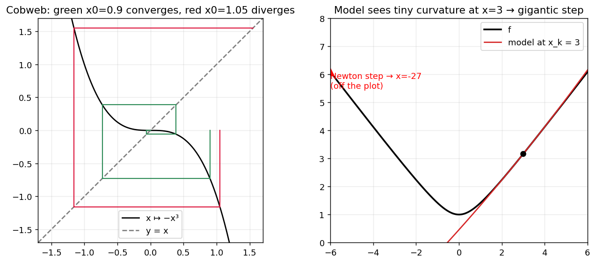
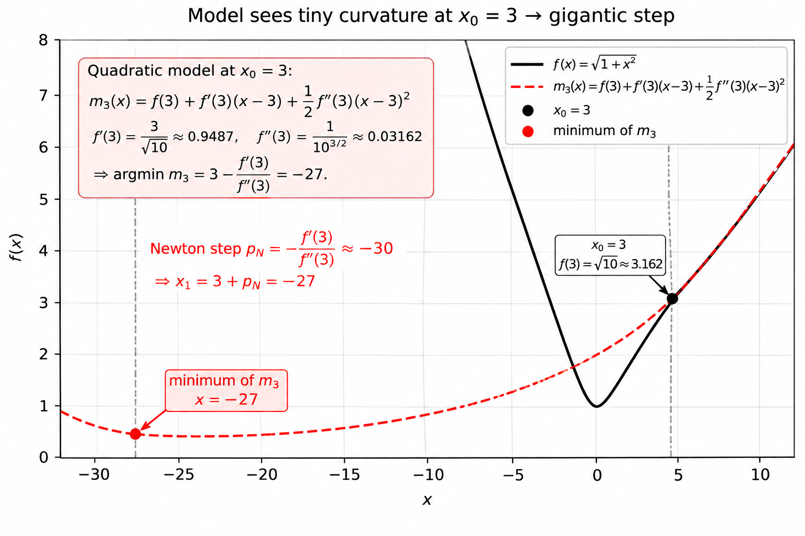

**What to look at.** Left: the cobweb of $x\mapsto-x^3$. The green path from $x_0=0.9$ spirals into $0$, and the red path from $x_0=1.05$ spirals out. Right: far from the minimizer $f$ is almost a straight line ($f\approx\lvert x\rvert$), so the model sees tiny curvature and proposes a gigantic step to the vertex of a very wide parabola, far past the minimizer.

$$
x_1=-(0.9)^3=-0.729,\\\\
x_2=-(-0.729)^3\approx0.3874,\\\\
x_3\approx-0.0581,\\\\
x_4\approx0.000196.\\\\
$$

The sequence alternates between positive and negative values, but its magnitude decreases:
$$
0.9\to0.729\to0.3874\to0.0581\to0.000196.
$$
**Taxonomy of failures and their cures.**

| Failure | Cause | Remedy |
|---|---|---|
| Converges to a saddle or maximizer | $H\not\succ0$ | Hessian modification (§10) |
| Ascent direction | $g^TH^{-1}g\le0$ | Hessian modification (§10) |
| Huge step, near-singular $H$ | $\lambda_{\min}\approx0$ | Hessian modification (§10) |
| Step too long though $H\succ0$ | model invalid far away | damping (§9), trust region (§11) |

## 9. Damped Newton and line search

**Goal.** Control the *length* of the Newton step with the line-search tools you already know.

**Idea.** Keep the Newton direction $p_k$, and take $x_{k+1}=x_k+\alpha_kp_k$ with $0<\alpha_k\le1$, always trying $\alpha=1$ first.

**Recall: Armijo (sufficient decrease).** Accept $\alpha$ if
$$f(x_k+\alpha p_k)\le f(x_k)+c_1\alpha\,g_k^Tp_k,\qquad c_1\in(0,\tfrac12).$$
**Backtracking:** start at $\alpha=1$ and multiply by $\rho=\tfrac12$ until the condition holds. The loop terminates **only if $g_k^Tp_k<0$**.

**Example.** $f=\sqrt{1+x^2}$ from $x_0=3$, $p=-30$, $c_1=10^{-4}$:

| $\alpha$ | $f(x_0+\alpha p)$ | Armijo bound | |
|---|---|---|---|
| 1 | 27.0185 | 3.1594 | reject |
| 1/2 | 12.0416 | 3.1609 | reject |
| 1/4 | 4.6098 | 3.1616 | reject |
| 1/8 | 1.2500 | 3.1619 | **accept** |

The new point is $x_1=3-30/8=-0.75$, inside the region $|x|<1$ where pure Newton converges cubically ($x_2=-x_1^3=0.42$).

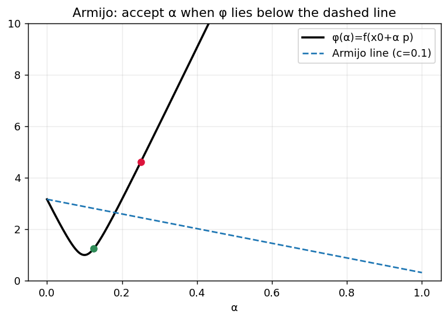

**What to look at.** $\phi(\alpha)=f(x_0+\alpha p)$ is the black curve. A step is accepted when $\phi$ lies **below** the dashed Armijo line. Only $\alpha=1/8$ (green) qualifies.

**Why it works (global convergence idea).** Suppose $mI\preceq H_k\preceq MI$. Then the angle $\theta_k$ between $-g_k$ and $p_k$ satisfies
$$\cos\theta_k=\frac{g_k^TH_k^{-1}g_k}{\lVert g_k\rVert\lVert H_k^{-1}g_k\rVert}\ge\frac{1/M}{1/m}=\frac mM,$$
because $g^TH^{-1}g\ge\lVert g\rVert^2/M$ and $\lVert H^{-1}g\rVert\le\lVert g\rVert/m$. So the Newton direction stays uniformly away from orthogonal to $-g_k$, and Zoutendijk's theorem gives $\lVert g_k\rVert\to0$. The guarantee degrades as $\kappa(H)$ grows.

**Keeping the fast local rate.** Near a minimizer with $H(x^{*})\succ0$, the full step $\alpha=1$ satisfies Armijo eventually if $c_1<\tfrac12$ (on an exact quadratic, $f(x+p)-f(x)=\tfrac12g^Tp$, so Armijo with $\alpha=1$ needs $c_1\le\tfrac12$). Damped Newton then becomes pure Newton and keeps quadratic convergence.

**The limitation.** Damping needs a descent direction. It cannot repair $H_k$ indefinite or singular. For that we must change the direction.

<details><summary><b>Check yourself</b></summary>

*Why does the line search fail on the saddle example of §7.1?* Because $g^Tp=+6>0$: every $\alpha>0$ increases $f$ to first order, so the Armijo loop never terminates.
</details>

## 10. Hessian modification — the cornerstone

**Goal.** Repair the *direction* when $H_k$ is not positive definite, and understand why one scalar $\lambda$ also controls the step length.

### 10.1 The idea

Do not change the objective. Change the model's Hessian so that the model has a well-defined minimizer:
$$\boxed{(H_k+\lambda I)\,p=-g_k,\qquad \lambda\ge0.}$$
If $H_k+\lambda I\succ0$ then $g^Tp=-g^T(H_k+\lambda I)^{-1}g<0$ for every $g\ne0$: **always a descent direction**.

### 10.2 The eigenbasis reading (the key to understanding it)

Write $H=\sum\lambda_iv_iv_i^T$ and $g=\sum\gamma_iv_i$. Then
$$p(\lambda)=-\sum_i\frac{\gamma_i}{\lambda_i+\lambda}\,v_i .$$
Mode $i$ is divided by $\lambda_i+\lambda$ instead of $\lambda_i$.

- $\lambda=0$: **Newton**.
- $\lambda\to\infty$: every denominator $\approx\lambda$, so $p\approx-g/\lambda$: **gradient descent with step $1/\lambda$**.
- $\lambda>-\lambda_{\min}(H)$: all denominators positive, **descent guaranteed**.

So $\lambda$ is a dial between "trust the curvature" (Newton) and "trust only the slope" (GD). Moreover
$$\lVert p(\lambda)\rVert^2=\sum_i\frac{\gamma_i^2}{(\lambda_i+\lambda)^2}$$
is **decreasing in $\lambda$**: the same parameter also shortens the step. One scalar controls both direction and length.

What it does to the bad modes:

- **Negative curvature mode** ($\lambda_i<0$): with $\lambda>\lvert\lambda_i\rvert$ the denominator becomes positive and the step now *descends* along it instead of climbing.
- **Near-zero mode** ($\lambda_i\approx0$): division by $\lambda_i$ is replaced by division by $\approx\lambda$, taming the huge step.

### 10.3 Geometric reading: a bowl added to the model

The modified step solves
$$\min_p\ m(p)+\tfrac\lambda2\lVert p\rVert^2 .$$
The shift adds a bowl centred at $x_k$ that **penalizes long steps** and turns a downward-opening parabola upward.

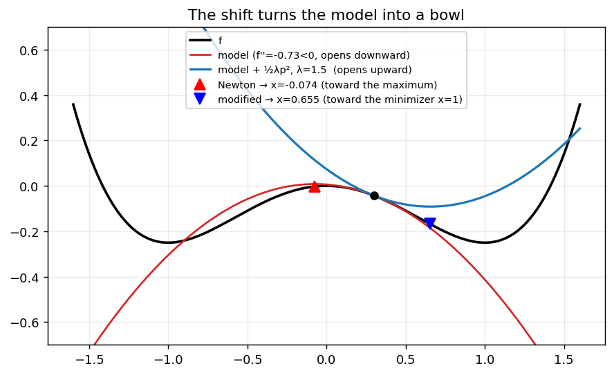

**What to look at.** $f=x^4/4-x^2/2$ at $x_k=0.3$. The red model opens downward ($f''=-0.73$), so Newton (red triangle) jumps to $x=-0.074$, **toward the local maximum**. The blue curve is the model plus $\tfrac\lambda2p^2$ with $\lambda=1.5$. It opens upward, its vertex is at $x=0.655$, and the step goes **toward the minimizer** $x=1$.

### 10.4 Five worked examples

All values come from the notebook (Part III §10).

**E1 — direction rotates from Newton to $-g$.** $H=\mathrm{diag}(1,100)$, $g=(1,1)$:

| $\lambda$ | $p(\lambda)$ | $\lVert p\rVert$ | $g^Tp$ |
|---|---|---|---|
| 0 | $(-1,\ -0.01)$ | 1 | $-1.01$ |
| 1 | $(-0.5,\ -0.0099)$ | 0.5001 | $-0.5099$ |
| 10 | $(-0.0909,\ -0.0091)$ | 0.0914 | $-0.1$ |
| 1000 | $(-0.001,\ -0.00091)$ | 0.00135 | $-0.0019$ |

The Newton direction is almost purely along $v_1$ (the soft mode), while $-g=(-1,-1)$ points diagonally. As $\lambda$ grows the direction rotates toward $-g$ (the figure below, left panel) and the length shrinks.

**E2 — ascent becomes descent.** The saddle $f=x^2-y^2$ at $(1,2)$: $g=(2,-4)$, $H=\mathrm{diag}(2,-2)$.

| $\lambda$ | $p$ | $g^Tp$ | $H+\lambda I\succ0$? |
|---|---|---|---|
| 0 | $(-1,\ -2)$ | $+6$ | no |
| 1 | $(-0.667,\ -4)$ | $+14.7$ | no |
| 2 | singular | — | — |
| 3 | $(-0.4,\ 4)$ | $-16.8$ | yes |
| 10 | $(-0.167,\ 0.5)$ | $-2.33$ | yes |

Descent appears **exactly** once $\lambda>2=-\lambda_{\min}$. Note the sign flip of the second component: the step now moves *along the negative-curvature direction in the downhill sense* ($y$ increases in magnitude, where $f=-y^2$ decreases).

**E3 — the threshold and the blow-up.** $H=\mathrm{diag}(3,-1)$, $g=(1,1)$, threshold $\lambda>1$.

| $\lambda$ | $p$ | $\lVert p\rVert$ |
|---|---|---|
| 0 | $(-0.333,\ +1)$ | 1.05 (ascent, $g^Tp=+0.67$) |
| 1.01 | $(-0.249,\ -100)$ | 100 |
| 1.1 | $(-0.244,\ -10)$ | 10 |
| 2 | $(-0.2,\ -1)$ | 1.02 |
| 10 | $(-0.077,\ -0.111)$ | 0.135 |

Just above the threshold, $H+\lambda I$ is nearly singular in the negative-curvature direction and the step explodes. **Lesson:** $\lambda$ should be safely above $-\lambda_{\min}$, not at it.

**E4 — the too-long step of §8.** $f=\sqrt{1+x^2}$ at $x_0=3$, $p=-f'/(f''+\lambda)$:

| $\lambda$ | $p$ | $x_1$ | $f(x_1)$ |
|---|---|---|---|
| 0 | $-30$ | $-27$ | 27.02 |
| 0.1 | $-7.21$ | $-4.21$ | 4.32 |
| 1 | $-0.920$ | $2.080$ | 2.308 |
| 10 | $-0.095$ | $2.905$ | 3.073 |

With $\lambda=1$ the step is $-0.92$ and $f$ drops from $3.162$ to $2.308$. The shift cures an over-long step too, even though $f''>0$ here.

**E5 — near-singular Hessian.** $H=\mathrm{diag}(10^{-8},1)$, $g=(1,1)$:

| $\lambda$ | $p$ | $\lVert p\rVert$ |
|---|---|---|
| 0 | $(-10^8,\ -1)$ | $10^8$ |
| 0.01 | $(-99.9999,\ -0.990)$ | 100 |
| 1 | $(-1,\ -0.5)$ | 1.12 |

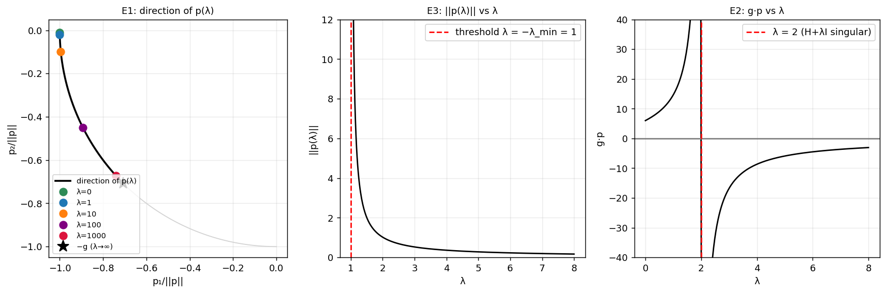

**What to look at.** Left (E1): the direction of $p(\lambda)$ on the unit circle sweeps from the Newton direction at $\lambda=0$ to $-g$ (star) as $\lambda\to\infty$. Middle (E3): $\lVert p(\lambda)\rVert$ is decreasing and blows up as $\lambda\downarrow1=-\lambda_{\min}$. Right (E2): $g^Tp$ is positive for $\lambda<2$ and negative for $\lambda>2$.

### 10.5 How to choose the modification in practice

1. **Eigenvalue modification** (expensive, instructive). Compute $H=V\Lambda V^T$ and replace each $\lambda_i$ by $\lvert\lambda_i\rvert$ or $\max(\lambda_i,\delta)$.
2. **Diagonal shift** $H+\lambda I$ — the simplest, used throughout this lecture.
3. **Trial-shift Cholesky** (the standard practical algorithm). Cholesky succeeds if and only if the matrix is positive definite, so its failure is a cheap test:

```text
tau = 0 if min diag(H) > 0 else  -min diag(H) + beta        (beta ~ 1e-3)
loop:
    try Cholesky of H + tau*I
    if it succeeds: break
    tau = max(2*tau, beta)
solve (H + tau*I) p = -g
```
4. *(mention only)* Modified Cholesky (Gill–Murray, Schnabel–Eskow) perturbs the diagonal during the factorization.

**Numbers for $H=\begin{pmatrix}3&2\\\\2&-1\end{pmatrix}$, $g=(1,1)$** (eigenvalues $-1.828$ and $3.828$):

| Method | Result |
|---|---|
| $\lvert\lambda_i\rvert$ modification | $p=(-0.202,\ -0.404)$ |
| $\max(\lambda_i,10^{-2})$ modification | $p=(20.4,\ -50.1)$ — **huge** |
| Trial-shift Cholesky | $\tau=2.002$ after 2 attempts, $p=(0.986,\ -2.966)$, $g^Tp=-1.98$ |

Two lessons. Clipping a negative eigenvalue up to a *tiny* $\delta$ creates a near-singular mode and a giant step, so it is a poor choice. Trial doubling may overshoot the minimal shift ($1.828$) by up to a factor 2, which is a cheap price for a robust test. In general, make $\tau$ as **small as will work**: a large $\tau$ throws away curvature information.

### 10.6 Combining it with line search

Use the modified direction inside Armijo backtracking (§9). The loop terminates because $g^Tp<0$ is now guaranteed, and the condition number of $H+\tau I$ is bounded, so $\cos\theta_k$ stays away from zero (global convergence as in §9). Near a minimizer with $H\succ0$ the shift becomes $0$ and the method reverts to pure Newton, so the **quadratic rate is recovered**.

### 10.7 Demonstration: double well

$f(x,y)=(x^2-1)^2+y^2$ has minimizers $(\pm1,0)$ and a saddle at the origin. Start at $(0.2,1)$, where $f_{xx}=12x^2-4=-3.52<0$.

- **Pure Newton** goes to $(0,0)$, a **saddle** (Hessian eigenvalues $-4$ and $2$ there, $\lVert g\rVert=0$).
- **Newton + shift + backtracking** uses $\tau=3.521$ at the first step (just above $3.52$), then $\tau=0$, and reaches the minimizer $(1,0)$ in **5 iterations**.

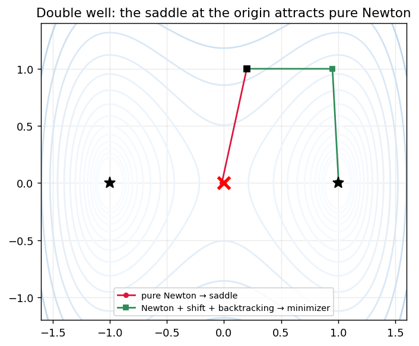

**What to look at.** The red path is attracted to the red $\times$ (the saddle). The green path takes a first, shifted step that moves away from the saddle, then converges to the minimizer $(1,0)$.

> **Honest remark about Rosenbrock (§18).** From $(-1.2,1)$ the shift is never activated (all $\tau=0$), and from the other starts we tried, pure Newton also reached the minimizer. So Rosenbrock does not *demonstrate* the need for modification; the double well does. Do not infer from one test function that a safeguard is unnecessary.

> 🔧 **Playground.** Change the starting point in the double-well cell. Try $(0.05,1)$ and $(-0.3,0.5)$. Where does pure Newton end up each time?

<details><summary><b>Check yourself</b></summary>

1. *For $H=\mathrm{diag}(3,-1)$, why is the smallest admissible $\lambda$ equal to $1$ and why is $\lambda=1$ itself bad?* $H+\lambda I\succ0$ iff $\lambda>1$. At $\lambda=1$ the matrix is singular and $\lVert p\rVert\to\infty$ (unless $\gamma_2=0$).
2. *Why does $\lambda\to\infty$ give gradient descent?* $(H+\lambda I)^{-1}\approx\lambda^{-1}I$, so $p\approx-g/\lambda$.
3. *Why not just use $\lvert H\rvert$ (take absolute values of eigenvalues)?* It works (first row of the table in §10.5), but needs an eigendecomposition ($O(n^3)$ and more than Cholesky), and it changes *every* mode's scale, not only the bad ones.
</details>

## 11. Trust-region methods

**Goal.** Choose the step length and the direction **together**, from an explicit measure of how reliable the model is.

So far $\lambda$ was chosen by trial and error. Can we choose it from how well the model predicts $f$?

### 11.1 The subproblem

$$\boxed{\min_p\ m_k(p)=f_k+g_k^Tp+\tfrac12p^TB_kp\quad\text{s.t.}\quad\lVert p\rVert\le\Delta_k}$$
$B_k$ is the Hessian (or an approximation), $\Delta_k$ the **trust-region radius**: the distance within which we believe the model.

**Why restrict the step?** The model error is $f(x_k+p)-m_k(p)=O(\lVert p\rVert^3)$ with the exact Hessian ($O(\lVert p\rVert^2)$ with an approximation). It is small only for small $\lVert p\rVert$.

**Two consequences.** (i) The subproblem always has a solution (compact feasible set), even for indefinite or singular $B_k$. (ii) Direction and length are chosen together, with no separate line search.

**Line search versus trust region:** line search chooses the direction first and the length second; trust region fixes the length bound first and finds the direction inside it.

### 11.2 The solution is a Hessian modification

**Theorem.** $p^{*}$ with $\lVert p^{*}\rVert\le\Delta$ is a global solution iff there is $\lambda\ge0$ such that
$$(B+\lambda I)p^{*}=-g,\qquad \lambda(\Delta-\lVert p^{*}\rVert)=0,\qquad B+\lambda I\succeq0 .$$
(These are the Lagrange/KKT conditions of the constrained problem.)

- **Interior solution:** $\lambda=0$, $Bp^{*}=-g$: the Newton step (when $B\succ0$).
- **Boundary solution:** $\lambda\ge0$ is the multiplier, found from $\lVert p(\lambda)\rVert=\Delta$.

This is **exactly the Hessian modification of §10**, but now $\lambda$ is not a trial shift: it is determined by the radius $\Delta$. Large $\Delta$ gives small $\lambda$ (Newton-like). Small $\Delta$ gives large $\lambda$ (gradient-like). Since $\lVert p(\lambda)\rVert$ is decreasing in $\lambda$ (§10.2), the equation $\lVert p(\lambda)\rVert=\Delta$ is a scalar root-finding problem (solved by Newton's method!).

*(Hard case.)* If $g$ is orthogonal to the eigenvector of the most negative eigenvalue, there may be no $\lambda>-\lambda_{\min}$ with $\lVert p(\lambda)\rVert=\Delta$. The solution then adds a multiple of that eigenvector to reach the boundary: negative curvature is **used**, not repaired. For $f=x^2-y^2$ at the saddle $(0,0)$ the model minimizer within $\lVert p\rVert\le\Delta$ is $(0,\pm\Delta)$, a step that escapes the saddle.

### 11.3 Cheap approximate solutions

**Cauchy point** (minimize $m$ along $-g$ within the ball):
$$p^C=-\tau\frac{\Delta}{\lVert g\rVert}g,\quad \tau=\begin{cases}1&g^TBg\le0\\\\\min\!\bigl(\lVert g\rVert^3/(\Delta\,g^TBg),\,1\bigr)&g^TBg>0\end{cases}$$
It guarantees $m(0)-m(p^C)\ge\tfrac12\lVert g\rVert\min(\Delta,\lVert g\rVert/\lVert B\rVert)$, the trust-region analogue of sufficient decrease.

**Dogleg** (for $B\succ0$): follow the path $0\to p^U\to p^B$ with $p^U=-\frac{g^Tg}{g^TBg}g$ and $p^B=-B^{-1}g$, and stop where it leaves the ball. Along the path $\lVert p\rVert$ increases and $m$ decreases.

**Example on the ellipse** ($x_0=(0.6,-0.4)$, $g=(10.5,9.5)$, $\Delta=0.25$; the Newton step has norm $0.721$, so the constraint is active):

| Solver | $p$ | $\lVert p\rVert$ | $m(p)$ |
|---|---|---|---|
| exact ($\lambda=2.393$) | $(-0.2450,\ 0.0497)$ | 0.250 | $-1.1251$ |
| dogleg | $(-0.2458,\ 0.0455)$ | 0.250 | $-1.1244$ |
| Cauchy | $(-0.1053,\ -0.0952)$ | 0.142 | $-1.0050$ |

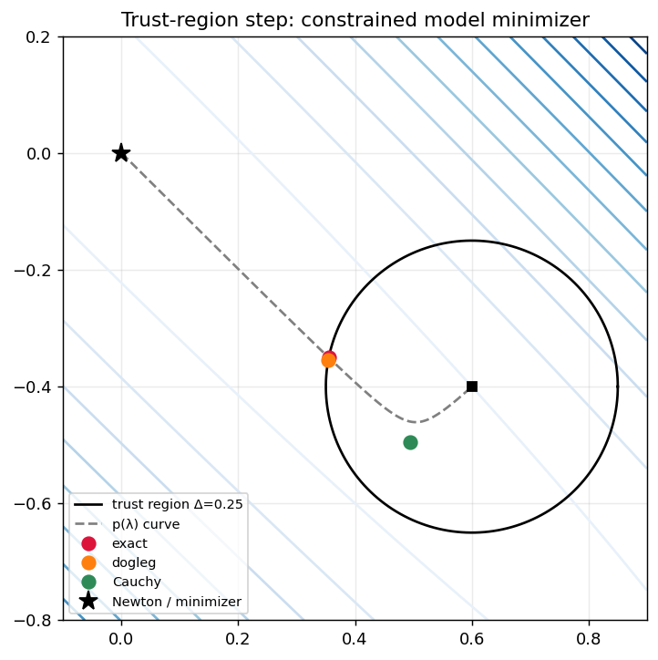

**What to look at.** The circle is the trust region around $x_0$ (black square). The dashed gray curve is $p(\lambda)$: it starts at the Newton point (star) for $\lambda=0$ and bends toward $-g$ as $\lambda$ grows. The exact solution (red) is where this curve crosses the circle; dogleg (orange) is almost the same point; Cauchy (green) stays on the gradient ray and gains much less.

### 11.4 Predicted versus actual reduction

$$\boxed{\rho_k=\frac{f(x_k)-f(x_k+p_k)}{m_k(0)-m_k(p_k)}=\frac{\text{actual reduction}}{\text{predicted reduction}}}$$

| $\rho_k$ | Meaning | Action |
|---|---|---|
| $\approx1$ | model matches $f$ | accept, may enlarge the region |
| positive but small | model optimistic | accept (if above $\eta$), maybe shrink |
| $\le0$ | $f$ did not decrease | **reject**, shrink the region |
| $>1$ | $f$ decreased more than predicted | accept |

> **Conceptual remark.** $\rho_k$ tests the **model against the function**, not the step. A bad $\rho_k$ is evidence that the model is invalid at distance $\Delta_k$, a statement about the **region**. That is why the response is to shrink $\Delta_k$, and not to try another direction at the same radius.

Example: for $f=\sqrt{1+x^2}$ at $x_0=3$, $\rho$ as a function of the radius:

| $\Delta$ | 1 | 2 | 4 | 8 | 16 | 30 |
|---|---|---|---|---|---|---|
| $\rho$ | 0.993 | 0.953 | 0.494 | $-0.294$ | $-0.887$ | $-1.676$ |

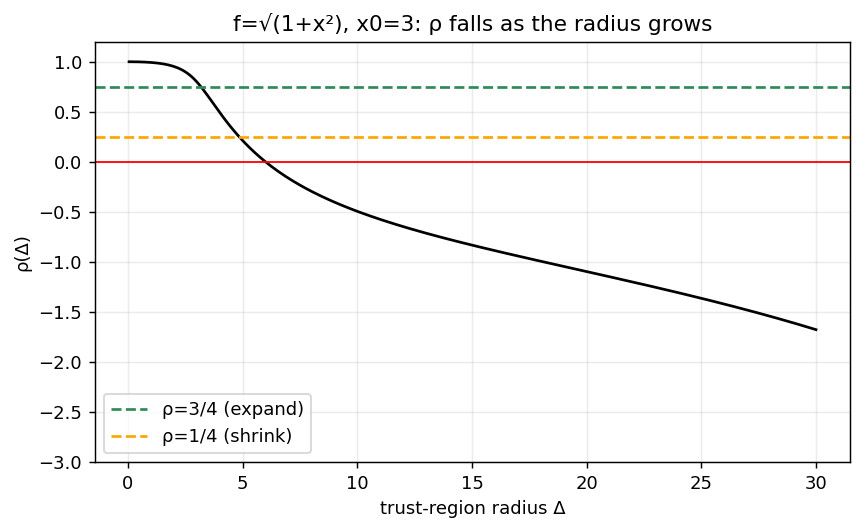

**What to look at.** $\rho(\Delta)$ falls as the radius grows and becomes **negative** somewhere between $\Delta=4$ and $\Delta=8$ (the table gives $0.494$ and $-0.294$): beyond that point the step *increases* $f$. The model is good close to $x_0$ and bad far away, which is exactly what the trust region is designed to exploit.

### 11.5 The algorithm

```text
Given Δ_max, Δ_0 in (0, Δ_max), η in [0, 1/4), x_0
for k = 0, 1, 2, ...
    p_k  = (approximate) solution of  min m_k(p)  s.t.  ||p|| <= Δ_k
    ρ_k  = (f(x_k) - f(x_k + p_k)) / (m_k(0) - m_k(p_k))
    if ρ_k < 1/4:                              Δ_{k+1} = (1/4) * ||p_k||      # shrink
    elif ρ_k > 3/4 and ||p_k|| = Δ_k:          Δ_{k+1} = min(2*Δ_k, Δ_max)    # expand
    else:                                      Δ_{k+1} = Δ_k
    if ρ_k > η:  x_{k+1} = x_k + p_k    else:  x_{k+1} = x_k                  # accept / reject
```
*Expand only if the step touched the boundary*: if $\lVert p_k\rVert<\Delta_k$ the radius was not binding. The constants $\tfrac14,\tfrac34,2$ are conventional.

**Worked example (1D).** $f=\sqrt{1+x^2}$ from $x_0=3$, $\Delta_0=1$:

| $k$ | $x_k$ | $\Delta_k$ | $\lVert p\rVert$ | $\rho_k$ | decision |
|---|---|---|---|---|---|
| 0 | 3 | 1 | 1 | 0.9929 | accept, $\Delta\to2$ |
| 1 | 2 | 2 | 2 | 0.7678 | accept, $\Delta\to4$ |
| — | 0 | — | — | — | $\nabla f=0$: stop |

Two iterations, **no function evaluations wasted on rejected trial steps**. Compare with damped Newton's four evaluations (§9).

**Worked example (2D double well from $(0.2,1)$, $\Delta_0=0.5$):**

| $k$ | $x_k$ | $\Delta_k$ | $\rho_k$ | decision |
|---|---|---|---|---|
| 0 | $(0.2,\ 1)$ | 0.5 | 0.918 | accept |
| 1 | $(0.620,\ 0.728)$ | 1 | $-0.477$ | **reject**, $\Delta\to0.25$ |
| 2 | $(0.620,\ 0.728)$ | 0.25 | 0.960 | accept |
| 3 | $(0.814,\ 0.571)$ | 0.5 | 0.893 | accept |
| 4 | $(1.055,\ 0.133)$ | 1 | 1.019 | accept |
| 5–7 | $\to(1,0)$ | 1 | 1.004, 1.000, 1.000 | accept (pure Newton) |

Step $k=1$ is the instructive one: $\Delta=1$ was too ambitious ($\rho<0$), the step was rejected, the radius shrank, and the next trial was excellent. Near the end, $\rho\to1$ and the step lies inside the region: the method **becomes pure Newton** with quadratic convergence.

### 11.6 Convergence

**Global.** If $f$ is bounded below with Lipschitz gradient, $\lVert B_k\rVert$ is bounded, and each step satisfies the Cauchy decrease: with $\eta=0$, $\liminf\lVert g_k\rVert=0$; with $\eta\in(0,\tfrac14)$, $\lim\lVert g_k\rVert=0$. No descent-direction check, no positive-definiteness is required.

**Second order.** With $B_k=\nabla^2f(x_k)$ and nearly exact subproblem solutions, limit points satisfy $\nabla f=0$ and $\nabla^2f\succeq0$ (the second-order necessary conditions). Hessian modification with line search does not give this in general.

<details><summary><b>Check yourself</b></summary>

1. *If $\rho_k<0$, which is changed: the direction at the same radius, or the radius?* The radius (shrink). The model is unreliable at that distance.
2. *When is the trust-region step equal to the Newton step?* When $B\succ0$ and $\lVert B^{-1}g\rVert\le\Delta$ ($\lambda=0$).
3. *Why is the subproblem solvable for indefinite $B$?* The feasible set is a compact ball, so a minimizer exists.
</details>

## 12. Comparing the globalization strategies

Organize by **what is controlled**:

| Method | Controls | Handles indefinite $H$? | Main question |
|---|---|---|---|
| Full Newton | nothing | no | Take the complete step? |
| Damped Newton (line search) | length only | no | How much of the Newton step? |
| Hessian modification | direction **and** length (via $\lambda$) | yes | How much curvature to trust? |
| Trust region | direction **and** length (via $\Delta$) | yes, naturally | Within what radius is the model reliable? |

Damping changes only the length. Hessian modification and trust regions change the direction too, so they are not "the Newton direction with a safeguard" — they are different (curvature-damped) directions that converge to Newton near a nondegenerate minimizer. Line search is a *tool* that damped Newton and modified Newton use, not a separate method.

---

# Part IV — Quasi-Newton methods for root finding

## 13. Why avoid the Jacobian?

**Goal.** Motivate replacing $J$ by something cheaper.

Newton's system $J(x_k)p_k=-F(x_k)$ costs: forming $J$ ($n^2$ derivatives), storing it ($n^2$ numbers), solving ($O(n^3)$). Often $J$ is not even available analytically.

**Idea.** *Learn* $J$ from the changes observed along the iterates. Note that gradient descent is already a (very crude) quasi-Newton method with $B=\tfrac1\alpha I$ (§4). We ask for a better $B$ at modest cost.

## 14. The secant method

**Goal.** The 1D prototype of every quasi-Newton method.

**Derivation.** Replace $F'(x_k)$ in Newton's formula by the slope through the last two points:
$$F'(x_k)\approx\frac{F(x_k)-F(x_{k-1})}{x_k-x_{k-1}},\qquad\boxed{x_{k+1}=x_k-F(x_k)\frac{x_k-x_{k-1}}{F(x_k)-F(x_{k-1})}}$$
**Geometry.** Newton uses the **tangent** line; the secant method uses the **chord** through two previously evaluated points. No derivative is needed.

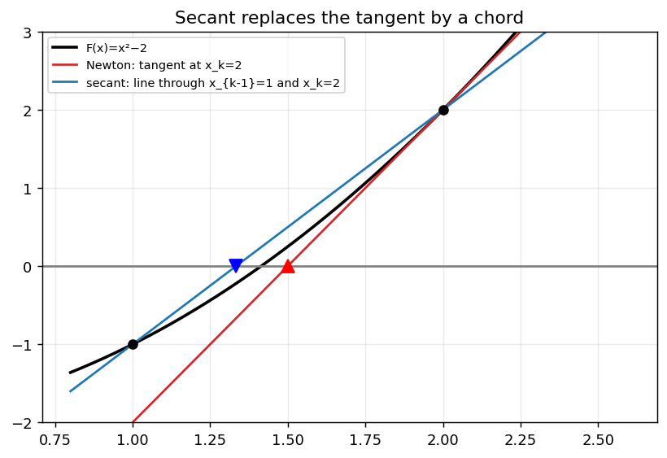

**What to look at.** For $x^2-2$ with $x_{k-1}=1$ and $x_k=2$: the red tangent at $x_k$ and the blue chord have different slopes and cross zero at different places.

**Example.** From $x_0=1$, $x_1=2$:

| $k$ | $x_k$ | error | $\ln e_{k+1}/\ln e_k$ |
|---|---|---|---|
| 2 | 1.33333 | $8.09\times10^{-2}$ | 1.69 |
| 3 | 1.40000 | $1.42\times10^{-2}$ | 1.83 |
| 4 | 1.41463 | $4.21\times10^{-4}$ | 1.68 |
| 5 | 1.414211 | $2.12\times10^{-6}$ | 1.68 |
| 6 | 1.41421356206 | $3.16\times10^{-10}$ | 1.65 |

The convergence order is the golden ratio $\frac{1+\sqrt5}2\approx1.618$ (**superlinear**, between linear and Newton's quadratic), at one function evaluation per iteration and no derivative.

## 15. Broyden's method

**Goal.** Extend the secant idea to $n$ dimensions.

Replace $J(x_k)$ by an approximation $B_k$: $B_kp_k=-F(x_k)$. With
$$s_k=x_{k+1}-x_k,\qquad y_k=F(x_{k+1})-F(x_k),$$
the **secant condition** demands that the new approximation reproduce the change observed along the last displacement:
$$\boxed{B_{k+1}s_k=y_k}$$
In 1D this is exactly the secant slope. In $n$ dimensions it is $n$ equations for $n^2$ unknowns, so there is freedom: Broyden chooses the update that changes $B_k$ **as little as possible** (smallest Frobenius change) while satisfying the condition:
$$\boxed{B_{k+1}=B_k+\frac{(y_k-B_ks_k)\,s_k^T}{s_k^Ts_k}}$$
**Meaning.** $y_k-B_ks_k$ is the error of the old model along $s_k$. The correction is a rank-one matrix that fixes exactly that error and leaves $B_k$ unchanged along every direction orthogonal to $s_k$. It is *not* an exact Jacobian; it is a model consistent with what we observed.

**Example.** Same system as §3, $x_0=(2,0.8)$, $B_0=J(x_0)$:

| $k$ | $\lVert F(x_k)\rVert$ | $\lVert B_{k+1}s_k-y_k\rVert$ | $\lVert B_{k+1}-J(x_{k+1})\rVert$ |
|---|---|---|---|
| 0 | $8.77\times10^{-1}$ | $10^{-16}$ | 0.395 |
| 1 | $8.23\times10^{-2}$ | $0$ | 0.288 |
| 2 | $5.81\times10^{-3}$ | $10^{-19}$ | 0.114 |
| 3 | $8.61\times10^{-4}$ | $10^{-20}$ | 0.0258 |
| 5 | $4.43\times10^{-9}$ | $0$ | 0.0258 |
| 6 | $1.65\times10^{-12}$ | $10^{-29}$ | 0.0257 |

Three observations: the secant condition holds to rounding error at every step; Broyden reaches $\lVert F\rVert<10^{-12}$ in 7 iterations versus 4 for Newton (slower but with no Jacobian evaluations after the first); and $B_k$ **does not converge to $J$** (the last column stalls at 0.026) yet the iteration still converges. It only needs to be right along the directions actually travelled.

> **Note for §16.** Broyden's update is **not symmetric**. A Hessian is symmetric, so it needs a different update.

<details><summary><b>Check yourself</b></summary>

*Why can't the secant condition alone determine $B_{k+1}$ for $n>1$?* It gives $n$ equations for $n^2$ unknowns; additional criteria (minimal change, symmetry, positive definiteness) are needed.
</details>

---

# Part V — Quasi-Newton methods for optimization

## 16. From Broyden to BFGS

**Goal.** Apply the secant idea to $F=\nabla f$, and see which extra properties an *optimization* quasi-Newton update needs.

With $F=\nabla f$: $B_kp_k=-\nabla f(x_k)$, $s_k=x_{k+1}-x_k$, $y_k=\nabla f(x_{k+1})-\nabla f(x_k)$, and the secant condition $B_{k+1}s_k=y_k$. By the mean value theorem $y_k\approx\bar Hs_k$: **changes in the gradient reveal the Hessian along the step.**

**Why a new update is needed.** The Hessian is symmetric and (near a minimizer) positive definite. Broyden's update preserves neither. **BFGS** satisfies the secant condition while keeping $B_k$ symmetric positive definite.

**The curvature condition.** Multiply the secant condition by $s_k^T$:
$$s_k^TB_{k+1}s_k=s_k^Ty_k .$$
For $B_{k+1}\succ0$ the left side is positive, so we need
$$\boxed{y_k^Ts_k>0}$$
This says: the average curvature along the step is positive.

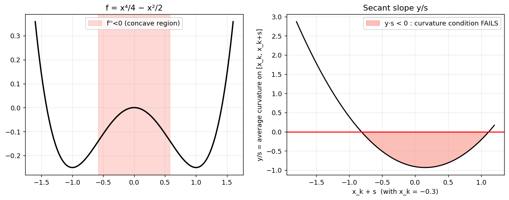

**What to look at.** $f=x^4/4-x^2/2$ is concave for $\lvert x\rvert<1/\sqrt3$ (left, shaded). Right: from $x_k=-0.3$, the slope $y/s$ is the average curvature on $[x_k,x_k+s]$. It is negative (shaded) when the step stays in the concave region. For example, a step from $-0.3$ to $0.2$ has $y/s=-0.93<0$: **no positive definite $B$ can satisfy $Bs=y$**.

**Wolfe conditions give a purpose.** The Wolfe curvature condition $\nabla f(x_k+\alpha p_k)^Tp_k\ge c_2\nabla f(x_k)^Tp_k$ guarantees $y_k^Ts_k>0$, whereas Armijo alone does not. This is why BFGS uses a Wolfe line search.

## 17. BFGS

**Notation** (to avoid clashes with $\rho_k$ of §11 and $H$ for the Hessian): $B_k$ is the Hessian approximation, $W_k=B_k^{-1}$ the inverse approximation, $\sigma_k=1/(y_k^Ts_k)$.

**The inverse update:**
$$\boxed{W_{k+1}=(I-\sigma_ks_ky_k^T)\,W_k\,(I-\sigma_ky_ks_k^T)+\sigma_ks_ks_k^T}$$
and the step is $p_k=-W_k\nabla f(x_k)$, found with no linear solve ($O(n^2)$ work).

**Properties.** (1) It satisfies the secant condition in inverse form, $W_{k+1}y_k=s_k$. (2) It preserves symmetry. (3) If $W_k\succ0$ and $y_k^Ts_k>0$ then $W_{k+1}\succ0$, so $p_{k+1}$ is a descent direction. (4) It incorporates new curvature information along $s_k$ while keeping what was learned before.

**Algorithm.**

```text
Given x_0, W_0 = I
for k = 0, 1, ...
    p_k = -W_k * g_k
    find α_k satisfying the Wolfe conditions
    x_{k+1} = x_k + α_k p_k;   s_k = x_{k+1}-x_k;   y_k = g_{k+1}-g_k
    W_{k+1} = (I - σ s y^T) W_k (I - σ y s^T) + σ s s^T,   σ = 1/(y^T s)
```

**Experiment 1: BFGS on the ellipse with exact line search.** $\lVert g\rVert$ per step: $14.2\to0.70\to3.9\times10^{-15}$: **two steps** (= $n$). The final $W$ equals $A^{-1}=\begin{pmatrix}0.505&-0.495\\\\-0.495&0.505\end{pmatrix}$ exactly: BFGS has *learned the inverse Hessian* from two secant pairs. (On quadratics with exact line search BFGS terminates in at most $n$ steps.)

**Experiment 2: Rosenbrock** $f=100(y-x^2)^2+(1-x)^2$ from $(-1.2,1)$. BFGS converges in 35 iterations. Along the way: the secant residual $\lVert B_{k+1}s_k-y_k\rVert\le5\times10^{-12}$, $y_k^Ts_k>0$ at every step, and the smallest eigenvalue of $W_k$ was $4.6\times10^{-4}>0$.

*Remark.* Quasi-Newton also needs globalization. Here the Wolfe line search provides it, and the Hessian-modification issue of §10 is bypassed because $B_k\succ0$ is preserved by construction.

**Why work with $W=B^{-1}$?** No linear solve per iteration. (Using $B$ directly with a Cholesky factor update is also possible, and is numerically better in some implementations.)

<details><summary><b>Check yourself</b></summary>

1. *What happens to BFGS if a step has $y_k^Ts_k\le0$?* The update can destroy positive definiteness, so implementations skip the update or enforce Wolfe to prevent it.
2. *Why does Broyden's update not suit optimization?* It is not symmetric and does not preserve positive definiteness.
</details>

## 18. Newton versus quasi-Newton

| | Newton | Quasi-Newton (BFGS) |
|---|---|---|
| Hessian | exact | approximate, learned from gradients |
| Derivatives required | second | first only |
| Cost per iteration | $O(n^3)$ solve, $O(n^2)$ storage | $O(n^2)$ (L-BFGS: $O(mn)$) |
| Local rate | quadratic | superlinear |
| Globalization | Hessian modification / trust region / line search | Wolfe line search |

**Rosenbrock, three methods from $(-1.2,1)$:**

| Method | Result |
|---|---|
| Gradient descent (backtracking) | after 5000 iterations $\lVert g\rVert=2.0\times10^{-3}$, $x=(0.99905,\ 0.99809)$: still not converged |
| Newton + shift + backtracking | **21** iterations to $\lVert g\rVert<10^{-8}$ |
| BFGS (Wolfe) | **35** iterations to $\lVert g\rVert<10^{-8}$ |

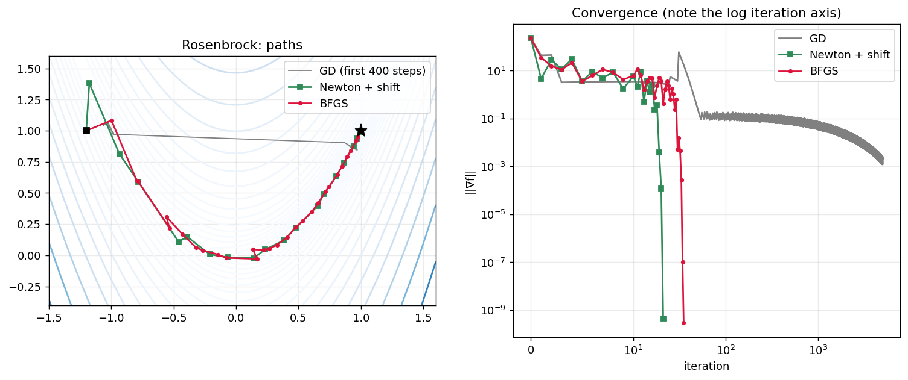

**What to look at.** Left: GD (gray) crawls along the curved valley, while Newton (green) and BFGS (red) reach $(1,1)$ in a few dozen steps. Right: $\lVert\nabla f\rVert$ on a log scale (note the log iteration axis). The tail shows the rates. Newton: $3.9\times10^{-3}\to1.2\times10^{-4}\to4.5\times10^{-10}$ (quadratic). BFGS: $\ldots2.7\times10^{-4}\to1.1\times10^{-7}\to2.9\times10^{-10}$ (superlinear).

**Affine invariance.** Newton's iterates are invariant under reparametrization $x=Ty$ and gradient descent is not. BFGS is invariant in exact arithmetic when $W_0$ transforms accordingly, but with $W_0=I$ it inherits some scaling dependence (a good $W_0$ matters in practice).

**L-BFGS** stores only the last $m$ pairs $(s_k,y_k)$ instead of the matrix $W_k$ (cost $O(mn)$), which makes it the workhorse for large-scale problems.

> 🔧 **Playground (notebook, §18).** Change `x0` (try `[0.5, 2.0]` and `[2.0, -1.0]`) and the Armijo constant `c`. Replace `chol_shift(H)` by a zero shift and see whether pure Newton still works from each start.

---

# Final synthesis

1. **Newton root finding:** local linearization turns a nonlinear problem into a sequence of linear ones.
2. **Newton optimization:** apply it to $\nabla f=0$. The Jacobian is the symmetric Hessian. Gradient descent is the same iteration with the crude Jacobian $\tfrac1\alpha I$, which causes its zigzag: stiff modes overshoot, soft modes crawl. Newton divides each mode by its own curvature, so on a quadratic the step is exactly $x^{*}-x$.
3. **Newton finds stationary points of a local model**, not necessarily minimizers, and the model is only valid nearby.
4. **Globalization** controls how the Newton step is used: damping (length only), **Hessian modification** $(H+\lambda I)p=-g$ (direction and length, interpolating between Newton and gradient descent), and **trust regions** (the same form of solution, with $\lambda$ set by a radius adapted from the observed ratio $\rho_k$).
5. **Quasi-Newton for root finding:** the secant condition $B_{k+1}s_k=y_k$ and Broyden's minimal-change update.
6. **Quasi-Newton for optimization:** BFGS keeps the approximation symmetric positive definite, which requires $y_k^Ts_k>0$, which the Wolfe conditions guarantee.

**Central idea.** Optimization algorithms need two kinds of information: *local geometry* (which determines the direction) and *the reliability of the local approximation* (which determines how to use that direction). Newton supplies exact curvature, globalization controls its use, and quasi-Newton makes it affordable.

---

# Exercises

1. **Distortion.** For $f=\tfrac12x^T\mathrm{diag}(1,100)x$, find all $x_0$ for which $-\nabla f(x_0)$ points exactly at the origin.
2. **Eigenmodes.** For GD on a quadratic, show $0<\alpha<2/\lambda_{\max}$ is the stability range and that $\min_\alpha\max_i\lvert1-\alpha\lambda_i\rvert=(\kappa-1)/(\kappa+1)$.
3. **Orthogonality.** Prove that exact line search on a quadratic gives $g_{k+1}^Tg_k=0$.
4. **Convergence order.** Apply Newton to $F(x)=x^3$ and to $f(x)=x^4$. Why is the rate only linear, and why does this not contradict §7.3?
5. **Saddle.** For $f=x^2-y^2$, show that damped Newton started on the $x$-axis converges to the saddle. What does Hessian modification do differently?
6. **Threshold.** For $H=\mathrm{diag}(3,-1)$, $g=(1,1)$, compute $\lVert p(\lambda)\rVert$ for $\lambda=1.001,1.01,1.1$ and explain the growth in terms of $\gamma_2/(\lambda_2+\lambda)$.
7. **Trust region.** Run the trust-region algorithm on $\sqrt{1+x^2}$ from $x_0=10$, $\Delta_0=1$. List $x_k,\rho_k,\Delta_k$.
8. **Hard case.** For $B=\mathrm{diag}(2,-1)$, $g=(1,0)$, $\Delta=2$, show no $\lambda>1$ solves $\lVert p(\lambda)\rVert=\Delta$ and construct the solution.
9. **Secant order.** Derive the error recurrence $e_{k+1}\approx Ce_ke_{k-1}$ and deduce the order $\frac{1+\sqrt5}2$.
10. **BFGS.** Verify that $W_{k+1}y_k=s_k$ for the inverse update, and that $W_{k+1}\succ0$ when $W_k\succ0$ and $y_k^Ts_k>0$.

---

# Suggested timetable

| Session | Content | Time |
|---|---|---|
| A | Part 0, Part I, Part II (§1–7) | 90 min |
| B | §8–9 (compressed), **§10 Hessian modification**, §11–12 | 90 min |
| C | Parts IV–V (§13–18) and synthesis | 90 min |

**Optional material that can move to a handout:** §6.3 (Hessian metric), the proof in §7.3, modified Cholesky details (§10.5), Cauchy point and dogleg (§11.3), L-BFGS (§18).
